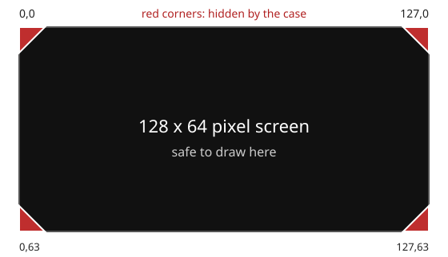

# Drawing to the Screen

After this page you can draw text, shapes and a small picture on the screen.

The Cyber Fidget has a 128 x 64 pixel monochrome OLED display. You draw to it by clearing a buffer, drawing primitives (text, shapes, bitmaps), and then pushing the buffer to the screen. The buffer keeps your drawing until you clear or change it. The usual app pattern redraws the whole frame.

---

## What is this?

The display works like an Etch A Sketch: you clear it, draw everything fresh, then show it. Calling `clear()` erases the drawing buffer, ready for a full redraw. Your `update()` loop is responsible for drawing the full picture every frame.

!!! tip "Like an Etch A Sketch"
    Clear it, draw everything fresh, then show it. Each frame is a complete redraw. Your code chooses when to clear the previous drawing.

---

## Display basics

- **Resolution:** 128 x 64 pixels
- **Type:** Monochrome OLED (black and white)
- **Coordinate system:** (0, 0) is top-left. X increases right, Y increases down.

Inside the [studio starter](../getting-started/first-app.md), `display` is ready to use in `begin()`, `update()` and `end()`. Paste fragments where their comments say; the starter shows the drawing with its final `display.display()` call.

`DisplayProxy` is the app interface, the set of drawing functions your app can use. In a helper at the top of the file, use `HAL::displayProxy()` to get the screen instead of the class member `display`.

```cpp
// Paste inside update(), just above display.display();
display.clear();
display.setTextAlignment(TEXT_ALIGN_CENTER);
display.setFont(ArialMT_Plain_16);
display.drawString(64, 24, "Hello!");
```

---

## Keep important pixels out of the corners

The case has a 45-degree corner cut (a *chamfer*) at each corner of the screen opening. Those cuts hide about 8 pixels at each corner of the 128 x 64 display: the hidden area is roughly a right triangle with 8-pixel sides, so a pixel drawn at (0, 0) is not visible on the device, and anything within about 8 pixels of a corner along both edges may be clipped.



*The four marked triangles are hidden by the case. The Studio emulator draws the real case, so it hides them the same way.*

- Keep text, score counters and key sprites out of the four 8 x 8 pixel corner areas.
- Backgrounds, borders and anything that is fine to lose can run into the corners.

The figure comes from the case's corner cuts: about 6% of the screen width (7.7 px of 128) and 12% of the screen height (7.9 px of 64), rounded to 8. It is an estimate taken from the case drawing, not a measured tolerance, so leave a pixel or two of margin.

---

## The clear -> draw -> display cycle

Every frame, follow this pattern:

1. **clear()** -- Erase the display buffer.
2. **draw** -- Add text, shapes, bitmaps.
3. **display()** -- Send the buffer to the physical screen.

Until you call `display()`, nothing appears on the OLED. All drawing goes to an internal buffer.

---

## Drawing primitives

### Text

```cpp
// Paste inside update(), just above display.display();
display.clear();
display.setFont(ArialMT_Plain_10);
display.setTextAlignment(TEXT_ALIGN_LEFT);
display.drawString(10, 10, "Hello!");
display.drawStringMaxWidth(10, 30, 108, "Short text");
```

`drawStringMaxWidth()` accepts a width, but studio apps draw one unwrapped line on the device and in the browser emulator. Keep lines short or draw separate lines yourself.

### Shapes

```cpp
// Paste inside update(), just above display.display();
display.clear();
display.drawRect(10, 10, 50, 20);
display.fillRect(10, 40, 50, 16);
display.drawCircle(84, 32, 15);
display.fillCircle(84, 32, 10);
display.drawLine(10, 10, 117, 53);
display.drawHorizontalLine(10, 32, 108);
display.drawVerticalLine(64, 8, 48);
```

### Bitmaps (drawXbm)

```cpp
// Paste at the top of the file, below the #include lines
static const uint8_t smile[8] = {
    0x3c, 0x42, 0xa5, 0x81, 0xa5, 0x99, 0x42, 0x3c
};

// Paste inside update(), just above display.display();
display.clear();
// drawXbm(x, y, width, height, data)
display.drawXbm(60, 28, 8, 8, smile);
```

A bitmap is an array of pixels. XBM stores one on/off bit per pixel, with the leftmost pixel in the lowest bit of each byte. This 8 x 8 image needs eight bytes. Larger pictures need more bytes; do not increase the dimensions without supplying enough data.

---

## Code example: text and shapes

The fixed `score` value below demonstrates drawing text. For a score that changes when you press a button, use the state and callback in [Buttons & Events](buttons.md#code-example-callback-registration). Change `ready` to `false` to draw only the circle outline.

```cpp
// Paste at the top of the file, below the #include lines
#include <stdio.h>

// Paste inside update(), just above display.display();
int score = 42;       // Replace with your game's score.
bool ready = true;
display.clear();
display.setFont(ArialMT_Plain_16);
display.setTextAlignment(TEXT_ALIGN_CENTER);
display.drawString(64, 4, "My App");
display.drawRect(10, 24, 108, 20);
display.setFont(ArialMT_Plain_10);
display.setTextAlignment(TEXT_ALIGN_LEFT);
char text[24];
snprintf(text, sizeof(text), "Score: %d", score);
display.drawString(14, 28, text);
display.drawCircle(64, 52, 6);
if (ready) display.fillCircle(64, 52, 4);
```

---

## Framework detail: DisplayProxy wrapping SSD1306Wire

??? info "Advanced: how the firmware drives the display"
    You do not need these details to build apps in the studio. They describe the firmware internals for readers writing an app by hand and building it into the firmware.

    Inside the firmware, the HAL creates a `SSD1306Wire` display driver and wraps it in a `DisplayProxy`. A driver is code that talks to a hardware part. This firmware-source excerpt is not for a studio app:

    <!-- check-examples: skip - firmware source excerpt, not a studio app -->
    ```cpp
    static SSD1306Wire s_realDisplay(0x3C, SDA, SCL);
    static DisplayProxy s_displayProxy(s_realDisplay);
    ```

    The firmware's `DisplayProxy` also manages overlays, drawings such as status icons over an app. Studio apps have a smaller set of functions: they do not control display contrast or orientation, and their overlay setters have no effect. Use the [app function reference](../reference/functions.md) for the calls available to your app; methods from the driver's documentation are not necessarily available.

## Functions on this page

--8<-- "includes/reference/display.md"
