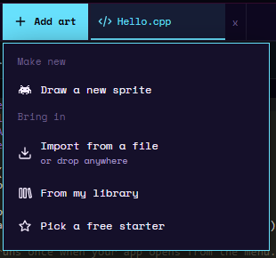
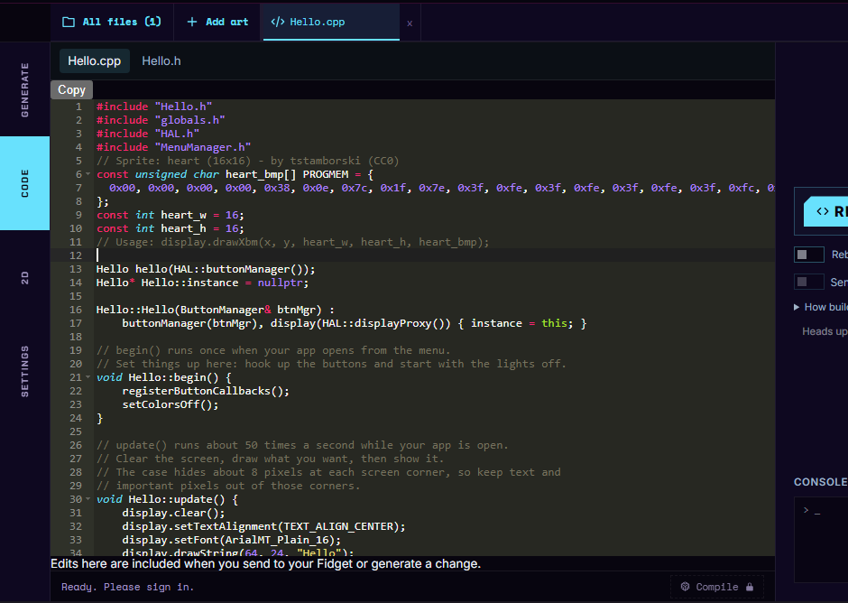
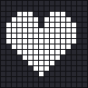
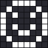
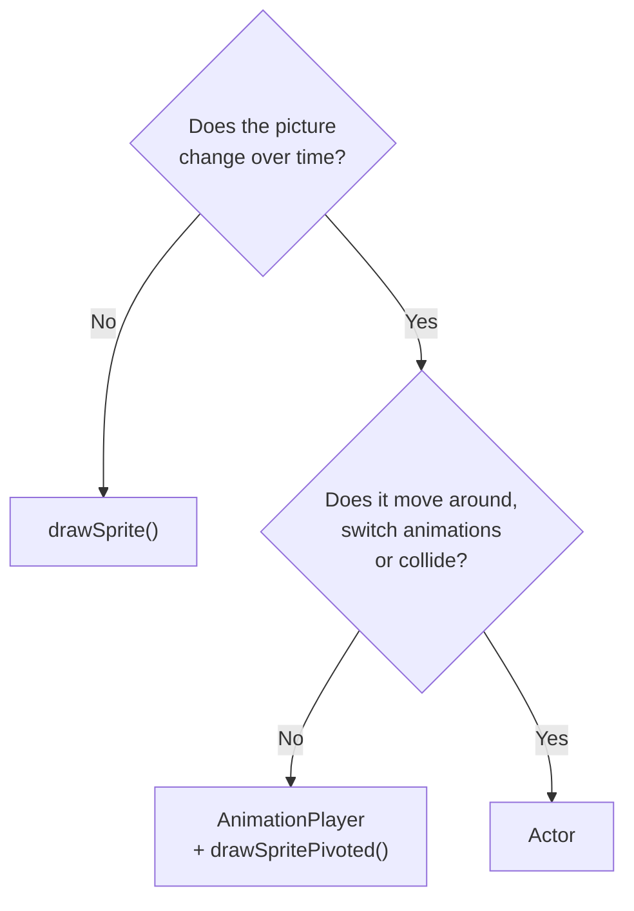
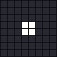
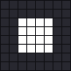
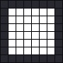
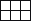

# Sprites & Animation

This page has two parts.

- **Part 1** puts your first sprite on the screen. It is a short tutorial with three ways to do it: draw it in the studio, copy a free starter, or write it in code. Pick one.
- **Part 2** explains each sprite feature with its own small example: drawing, pivots, animation, actors, loop modes and collision. Read it in order, or jump to what you need.

After this page you can show pictures in your app, animate them, move them with the buttons and the slider, and check when two of them touch.

<video src="../../assets/media/emulator-sprites.webm" poster="../../assets/media/emulator-sprites.png" autoplay loop muted playsinline width="300"></video>

*The emulator running the [Moving an actor](#moving-an-actor) example from Part 2: a small face that the slider moves up and down and the middle buttons move sideways.*

---

## What is this?

A **sprite** is a small picture your app draws on the screen: a character, a ball, a coin, a spark. On the Cyber Fidget every sprite is a **1-bit bitmap**. A bitmap is a picture stored as a grid of pixels, and 1-bit means each pixel is either on (lit) or off. There are no colors or grays, which matches the screen.

!!! tip "Like a rubber stamp"
    You make the stamp once. Then you can press it anywhere on the page, as often as you like. An animation is a stack of stamps you swap quickly, like a flip book.

The words on this page:

| Word | Meaning |
|------|---------|
| **Sprite** | One small 1-bit picture, plus its size and its pivot. |
| **Bitmap** | A picture stored as a grid of on/off pixels. |
| **XBM** | X BitMap: the way the bytes of a bitmap are laid out (see [Drawing a sprite](#drawing-a-sprite)). |
| **Pivot** | The point on a sprite that lands on the screen position you give. |
| **Frame** | One picture in an animation. |
| **Animation** | A named list of frames, how long each one shows, and what happens at the end. |
| **Sprite sheet** | A named group of animations that belong to one character or object. |
| **Actor** | A thing on the screen: a position plus an animation that is playing. |
| **Collision** | Two sprites touching, meaning a lit pixel of one sits on a lit pixel of the other. |

Every example on this page goes into a fresh [blank template](../getting-started/first-app.md) and works on its own. The first line of each part of an example says where to insert it. The first build of a new app uses **REBUILD & RUN**; after that, use **REBUILD**.

---

## Part 1: your first sprite on the screen

There are three ways to get a picture into your app. **They are alternatives, not steps.** Pick the one that suits you; each one ends with a working app.

| Option | Choose it when | You need |
|--------|----------------|----------|
| [A. Draw it in the studio](#option-a-draw-it-in-the-studio) | You want to draw your own picture, and maybe animate it. | A mouse, trackpad or finger. |
| [B. Copy a free starter](#option-b-copy-a-free-starter) | You want ready-made art: hearts, characters, icons. | Nothing. |
| [C. Write it in code](#option-c-write-it-in-code) | The picture is tiny, or you want to see how sprites work inside. | Nothing. |

### Option A: draw it in the studio

The studio turns every sprite you draw into code and adds it to your app when you build. There is nothing to export.

1. Open your app in the studio. Press **Add art** at the top of the workspace, then **Draw a new sprite**. (In the **2D** tab of a project with no art yet, **DRAW A SPRITE** does the same.)

    { width="310" }

2. The **New sprite** box opens. Type `Ball` as the **Sprite name** and press **Create**.

    { width="400" }

3. The **2D** tab opens a tab called `Ball.sprite` with a blank canvas the size of the screen (128 x 64 pixels). Draw your ball. The clip below draws a circle and fills it with **FILL**.

    <video preload="none" data-src="../../assets/media/new-sprite.webm" poster="../../assets/media/new-sprite.png" loop muted playsinline width="480"></video>

    *Add art, Draw a new sprite, name it Ball, Create, then draw a circle and fill it.*

    { width="480" }

4. Go back to the **CODE** tab and open your `.cpp` file. Insert these lines where their first lines say:

<!-- check-examples: skip - needs a sprite named Ball in the project's art -->
```cpp
// Insert at the top of the file, below the #include lines
#include "cf_gfx.h"
using namespace cf::gfx;
// The thing on the screen that shows your Ball sprite.
static Actor ballActor;

// Insert inside begin(), below setColorsOff();
// Use the sprite sheet the studio made from your Ball drawing.
ballActor.setSheet(&ball::sheet);
// (64, 64) is the middle of the bottom edge of the screen.
ballActor.setPos(64, 64);
ballActor.play("idle", millis());

// Insert inside update(), just above display.display();
display.clear();
ballActor.update(millis());
ballActor.draw(display);
```

??? example "Full code for Option A"

    This is the complete `MyApp.cpp` for code name `MyApp` (App Name "My App") with a sprite named `Ball` in the project. Keep the starter's `MyApp.h`. If your app has another code name, change `MyApp` and `myApp` to yours. The studio supplies the `ball::sheet` art when it builds.

    <!-- check-examples: skip - needs a sprite named Ball in the project's art -->
    ```cpp title="MyApp.cpp"
    #include "MyApp.h"
    #include "globals.h"
    #include "HAL.h"
    #include "MenuManager.h"

    #include "cf_gfx.h"
    using namespace cf::gfx;
    // The thing on the screen that shows your Ball sprite.
    static Actor ballActor;
    MyApp myApp(HAL::buttonManager());
    MyApp* MyApp::instance = nullptr;

    MyApp::MyApp(ButtonManager& btnMgr) :
        buttonManager(btnMgr), display(HAL::displayProxy()), audio(HAL::audioManager()) { instance = this; }

    // begin() runs once when your app opens from the menu.
    // Set things up here: hook up the buttons and start with the lights off.
    void MyApp::begin() {
        registerButtonCallbacks();
        setColorsOff();
        // Use the sprite sheet the studio made from your Ball drawing.
        ballActor.setSheet(&ball::sheet);
        // (64, 64) is the middle of the bottom edge of the screen.
        ballActor.setPos(64, 64);
        ballActor.play("idle", millis());
    }

    // update() runs about 50 times a second while your app is open.
    // Clear the screen, draw what you want, then show it.
    // The case hides about 8 pixels at each screen corner, so keep text and
    // important pixels out of those corners.
    void MyApp::update() {
        display.clear();
        display.setTextAlignment(TEXT_ALIGN_CENTER);
        display.setFont(ArialMT_Plain_16);
        display.drawString(64, 24, "MyApp");
        display.clear();
        ballActor.update(millis());
        ballActor.draw(display);
        display.display();
    }

    // end() runs when your app closes. Let go of the buttons and turn the
    // lights off (if your app plays sounds, call audio.stopTone() here too).
    void MyApp::end() {
        unregisterButtonCallbacks();
        setColorsOff();
    }

    // The bottom-left button closes your app and goes back to the menu.
    void MyApp::onButtonBackPressed(const ButtonEvent& event) {
        if (event.eventType == ButtonEvent_Released) {
            instance->end();
            MenuManager::instance().returnToMenu();
        }
    }

    void MyApp::registerButtonCallbacks() {
        buttonManager.registerCallback(button_BottomLeftIndex, onButtonBackPressed);
    }

    void MyApp::unregisterButtonCallbacks() {
        buttonManager.unregisterCallback(button_BottomLeftIndex);
    }
    ```

**Press REBUILD.** You see your ball exactly where you drew it on the canvas. [Actors](#actors) explains each line.

!!! warning "Give your actor its own name"
    Call the actor `ballActor`, not `ball`. The studio already uses your sprite's name, `ball`, for the art it makes, and after `using namespace cf::gfx;` two things called `ball` make the build stop with "reference to 'ball' is ambiguous". Adding `Actor` (or any other word) to the end keeps the names apart.

**How your sprite's name becomes a name in code.** The studio makes the name lowercase, turns each run of other characters (spaces, punctuation, accented letters) into one `_`, and trims `_` from both ends:

| Sprite name you type | Name in code | Why |
|----------------------|--------------|-----|
| `Ball` | `ball` | Lowercase. |
| `Big Ball` | `big_ball` | The space becomes `_`. |
| `1UP` | `_1up` | A name in code cannot start with a digit, so `_` goes in front. |
| `Ball` (a second sprite with the same name) | `ball_2` | Each sprite needs its own name. |
| `!!!` (no letters or digits) | `sprite` | Nothing usable is left, so the studio picks one. |

Simple names (English letters and digits, starting with a letter) are the easiest to use.

**What the studio makes from your sprite.** Each name below belongs to your sprite's name in code (here `ball`), and each comes from one part of the **2D** tab:

| Name in code | What it is | Where it comes from in the 2D tab |
|--------------|------------|-----------------------------------|
| `ball::sheet` | The sprite sheet: all of the sprite's animations. | The whole sprite file: the `Ball.sprite` tab. |
| `ball::anim_run` | The animation called `run`, if the sprite has one. | An animation in the frame strip at the bottom, made with **ADD ANIMATION** and named `run`. |
| `ball::cel_0` | The first frame as a single sprite (`cel_1` is the second, and so on). | **Frame 1** in the frame strip (frames are numbered from 1 there, and from 0 in code). |

"Cel" is an animator's word for one picture of an animation. A sprite with no animations gets one called `idle`, which loops through all its frames. Animations drawn in the studio loop. Each frame is trimmed to its lit pixels, and its pivot is the middle of the bottom edge of the canvas. **Draw a new sprite** starts with a canvas the size of the screen, so a position of (64, 64) puts the drawing exactly where you drew it.

!!! tip "Keep this, make it your own"
    **Keep:** `setSheet()`, `play()`, `update()` and `draw()`, in those places. They are what makes an actor show and animate.

    **Change:** the sprite and its drawing, the actor's name, and the position in `setPos()`. A different sprite name means a different name in code (`&big_ball::sheet` for **Big Ball**).

    **What a change affects:** adding frames does nothing on its own. The `idle` animation plays every frame only while the sprite has no animations of its own. Once you add an animation in the frame strip, `idle` is gone, so play your animation by its name instead, for example `ballActor.play("run", millis());`.

!!! info "Want to bring in art from another tool?"
    If you drew your picture in Aseprite or another editor, the studio can bring it in: **Add art** > **Import from a file**, or **Upload your own** in the free starters (an image up to 64 x 64 pixels, turned into black and white). Open [Bring in art from Aseprite](../software/import-export.md#bring-in-art-from-aseprite) or [Your Sprite Library](../studio/your-sprite-library.md) in a new tab, follow it, then come back here for step 4.

### Option B: copy a free starter

The studio has a library of free starter sprites that anyone may reuse. **Copy as C++** puts one on your clipboard as code.

1. Press **All files** at the top left of the workspace, then the **Free starters** tab. (**Add art** > **Pick a free starter** opens the same place.) Inside it, the **Starter Sprites** heading opens and closes the collection.

    { width="480" }

2. Type `heart` in **Search sprites...** and press **Preview** on the first heart.
3. A preview opens with three buttons. They sit below the visible part of the panel, so scroll down inside the panel to see them. Press **Copy as C++**.

    { width="480" }

4. Close the panel. In your `.cpp` file, click at the start of the line just below the four `#include` lines and paste (Ctrl+V, or Cmd+V on a Mac).

    <video preload="none" data-src="../../assets/media/free-starters-copy.webm" poster="../../assets/media/free-starters-copy.png" loop muted playsinline width="480"></video>

    *All files, Free starters, search for heart, Preview, scroll down, Copy as C++, then paste below the #include lines.*

    { width="480" }

The copied code has four parts: a credit line, the picture as a list of bytes (`heart_bmp`), its width (`heart_w`) and height (`heart_h`), and a comment showing one way to draw it. Those declarations are already at the top of your file. To use the sprite functions, wrap the picture in a `Sprite` and draw it.

**Replace the copied lines with the top-of-file section below, rather than adding a second copy.** It includes the same picture declarations followed by the wrapper. Keep each of `heart_bmp`, `heart_w` and `heart_h` exactly once. (Copied a different starter? Keep your copied lines, and below them add only the `using namespace cf::gfx;` line and the `static const Sprite ...` line from the block, with your sprite's names in place of `heart_bmp`, `heart_w` and `heart_h`. If you give the `Sprite` a different name than `heartSprite`, use that name in `drawSprite()` too.) Then insert the `update()` section just above `display.display();`.

{ .no-lightbox width="97" }

```cpp
// Insert at the top of the file, below the #include lines
// Sprite: heart (16x16) - by tstamborski (CC0)
const unsigned char heart_bmp[] PROGMEM = {
  0x00, 0x00, 0x00, 0x00, 0x38, 0x0e, 0x7c, 0x1f, 0x7e, 0x3f, 0xfe, 0x3f, 0xfe, 0x3f, 0xfe, 0x3f,
  0xfc, 0x1f, 0xf8, 0x0f, 0xf0, 0x07, 0xe0, 0x03, 0xc0, 0x01, 0x80, 0x00, 0x00, 0x00, 0x00, 0x00
};
const int heart_w = 16;
const int heart_h = 16;
// Usage: display.drawXbm(x, y, heart_w, heart_h, heart_bmp);

// Your lines: wrap the copied picture in a Sprite.
#include "cf_gfx.h"
using namespace cf::gfx;
// bytes, width, height, pivot x, pivot y, bit order
static const Sprite heartSprite = {heart_bmp, heart_w, heart_h, 0, 0, BO_LSB_FIRST};

// Insert inside update(), just above display.display();
display.clear();
// The top-left corner of the heart lands on (56, 24).
drawSprite(display, heartSprite, 56, 24);
```

**Press REBUILD.** You see a heart in the middle of the screen.

`PROGMEM` marks constant picture data for storage with the program on small boards. Keep it when copying sprite code. [Drawing a sprite](#drawing-a-sprite) explains the six values inside the `Sprite`.

!!! tip "Keep this, make it your own"
    **Keep:** the copied lines as they are, including the credit line. Free starters are free to reuse, and the credit says who made them.

    **Change:** which starter you copy, the `Sprite`'s name, and where you draw it. Another starter has its own names: a sprite called `coin` gives you `coin_bmp`, `coin_w` and `coin_h`, so use those in the `Sprite` line.

    **Why `heartSprite` and not `heart`:** if you later add the same art to the project with **Copy to Project**, the studio names it `heart` in code. A different name for your `Sprite` keeps the two apart.

### Option C: write it in code

For a tiny picture, you can write the bytes yourself. This is an 8 x 8 smiley face:

{ .no-lightbox width="81" }

```cpp
// Insert at the top of the file, below the #include lines
#include "cf_gfx.h"
using namespace cf::gfx;
// An 8 x 8 smiley face. Each byte is one row, top to bottom.
static const uint8_t smileBits[] = {
    0x3c, 0x42, 0xa5, 0x81, 0xa5, 0x99, 0x42, 0x3c
};
// bytes, width, height, pivot x, pivot y, bit order
static const Sprite smile = {smileBits, 8, 8, 0, 0, BO_LSB_FIRST};

// Insert inside update(), just above display.display();
display.clear();
// The top-left corner of the face lands on (60, 28).
drawSprite(display, smile, 60, 28);
```

**Press REBUILD.** You see an 8 x 8 smiley face in the middle of the screen.

[Drawing a sprite](#drawing-a-sprite) explains how the bytes make the face. The rest of Part 2 uses small sprites like this one, so every example works without drawing anything first.

!!! tip "Keep this, make it your own"
    **Keep:** the `Sprite` line's shape: bytes, width, height, pivot x, pivot y, `BO_LSB_FIRST`.

    **Change:** the bytes, to draw a different picture. If you change the size, change the width and height to match, and give each row enough bytes (one byte for every 8 pixels of width).

!!! note "Short names for the sprite functions"
    The sprite functions live in `cf_gfx.h`. Their full names start with `cf::gfx::`, as in `cf::gfx::drawSprite`, which is how the [function reference](../reference/functions.md#sprites-and-animation) lists them. `cf::gfx` is a **namespace**: a family name that keeps these functions apart from other code that might use the same names.

    The line `using namespace cf::gfx;` lets you write the short names (`drawSprite`, `Sprite`, `Actor`). Always add it in studio apps. A project with no sprites of its own refuses any build whose code writes out a `cf::gfx::` name, with the message "The generated art couldn't be used, and the app's code depends on it - so this app won't build. Try generating again."

---

## Part 2: how sprites work

Each section below has its own example. Every example goes into a fresh blank template on its own.

### Which one do I need?

Three tools draw sprites. Start with the simplest one that does what you need:

| You want | Use | What it does for you |
|----------|-----|----------------------|
| A picture that never changes (a wall, an icon, a heart) | [`drawSprite()`](#drawing-a-sprite) or [`drawSpritePivoted()`](#pivots) | Draws one sprite where you say. Nothing else. |
| A picture that animates, at a place your own code works out | An [`AnimationPlayer`](#animations-and-sprite-sheets), then `drawSpritePivoted()` | Picks which frame to show at each moment. You draw it. |
| A character that moves around, switches between animations (idle, run, jump) or bumps into things | An [`Actor`](#actors) | Keeps the position, the animations and the player together, plays animations by name, and works with [`pixelCollides()`](#collision). |



---

## Drawing a sprite

A `Sprite` holds six things, in this order:

| Value | In the smiley | Meaning |
|-------|---------------|---------|
| Bytes | `smileBits` | The picture (see below). |
| Width | `8` | Width in pixels. |
| Height | `8` | Height in pixels. |
| Pivot x | `0` | Where the [pivot](#pivots) sits, counted from the left edge. |
| Pivot y | `0` | Where the pivot sits, counted from the top edge. |
| Bit order | `BO_LSB_FIRST` | Always `BO_LSB_FIRST`. |

`drawSprite(display, smile, 60, 28)` draws the sprite with its top-left corner at x 60, y 28. The screen is 128 pixels wide and 64 tall, and y counts down from the top.

The smiley example in [Option C](#option-c-write-it-in-code) uses a few C++ words for the first time:

- `uint8_t` is a whole number from 0 to 255: exactly one byte.
- `smileBits[]` is an **array**: a numbered list of values. The `[]` tells C++ to count the values in `{ }` for you.
- `const` means the value never changes after it is made. Pictures don't change, so sprites are `const`.
- `static` in front of something at the top of the file keeps it to this file, so it can't clash with names elsewhere in the firmware.

### How the bytes make the picture

The bytes are in **XBM** order. Each row of the picture uses one byte for every 8 pixels of width, from top to bottom. Inside a byte, the lowest bit is the leftmost pixel. So write a byte in binary, then read it from **right to left**:

{ .no-lightbox width="81" }

| Row | Byte | Binary | Pixels, left to right (`#` is lit) |
|-----|------|--------|------------------------------------|
| 0 | `0x3c` | `00111100` | `..####..` |
| 1 | `0x42` | `01000010` | `.#....#.` |
| 2 | `0xa5` | `10100101` | `#.#..#.#` |
| 3 | `0x81` | `10000001` | `#......#` |
| 4 | `0xa5` | `10100101` | `#.#..#.#` |
| 5 | `0x99` | `10011001` | `#..##..#` |
| 6 | `0x42` | `01000010` | `.#....#.` |
| 7 | `0x3c` | `00111100` | `..####..` |

A sprite 10 pixels wide needs 2 bytes per row, and the unused bits are ignored. Drawing your sprite in the studio and letting it make the bytes is much easier for anything bigger than this.

`drawSprite()` uses the same drawing as `display.drawXbm()` (see [Bitmaps](display.md#bitmaps-drawxbm)). The difference is that a `Sprite` keeps its size and pivot with its bytes, so the other functions on this page can use it.

---

## Pivots

The **pivot** is the point on a sprite that lands on the screen position you give. With the pivot at the middle of the bottom edge, a character "stands" on the y you give, wherever its feet are. `drawSpritePivoted()` uses the pivot; `drawSprite()` ignores it.

{ .no-lightbox width="81" }

```cpp
// Insert at the top of the file, below the #include lines
#include "cf_gfx.h"
using namespace cf::gfx;
static const uint8_t smileBits[] = {
    0x3c, 0x42, 0xa5, 0x81, 0xa5, 0x99, 0x42, 0x3c
};
// The pivot is (4, 8): the middle of the bottom edge.
static const Sprite smile = {smileBits, 8, 8, 4, 8, BO_LSB_FIRST};

// Insert inside update(), just above display.display();
display.clear();
display.drawHorizontalLine(16, 40, 96);
// The pivot lands on (40, 40), so the face sits on the line.
drawSpritePivoted(display, smile, 40, 40);
// drawSprite ignores the pivot: the top-left corner lands on (80, 40).
drawSprite(display, smile, 80, 40);
```

**Press REBUILD.** You see two faces and a horizontal line. The left face sits on the line. The right face hangs below it. Pivots can also sit outside the picture, and they can be negative.

---

## Animations and sprite sheets

Animation is the biggest step on this page, so it comes in small pieces, one new idea each:

1. [Frames and timing](#frames-and-timing): what an animation is.
2. [Pointing at a sprite](#pointing-at-a-sprite): the C++ symbols `&`, `*` and `nullptr`.
3. [Play an animation](#play-an-animation): the first example.
4. [Several animations in a sprite sheet](#several-animations-in-a-sprite-sheet): choosing an animation by name.

If you drew your sprite in the studio, the studio writes all of this for you, and an [actor](#actors) plays it. Read on to understand what it made, or to build an animation by hand.

### Frames and timing

An **animation** is a list of **frames** (sprites), how long each one shows in milliseconds (thousandths of a second), and what happens after the last one (its [loop mode](#loop-modes)). An **animation player** keeps track of time and tells you which frame to show right now.

The example below blinks a face: eyes open for 1500 milliseconds (1.5 seconds), then shut for 150 milliseconds, then open again, forever.

{ .no-lightbox width="81" } { .no-lightbox width="81" }

*Frame 0 (eyes open) and frame 1 (eyes shut), enlarged.*

| Time since `play()` | Frame showing |
|---------------------|---------------|
| 0 to 1499 ms | Frame 0, eyes open |
| 1500 to 1649 ms | Frame 1, eyes shut |
| 1650 to 3149 ms | Frame 0 again (the animation loops) |
| 3150 to 3299 ms | Frame 1 |
| ... | and so on |

Each frame starts when the one before it has shown for its full time. One full blink cycle takes 1500 + 150 = 1650 ms.

### Pointing at a sprite

An animation doesn't copy its frames' pictures. It keeps a note of **where each sprite is stored** in memory, its **address**. Three small symbols do this:

| You write | Say it as | Means |
|-----------|-----------|-------|
| `&eyesOpen` | "the address of `eyesOpen`" | Where the sprite `eyesOpen` is stored. |
| `const Sprite*` | "a pointer to a sprite" | A value that holds the address of a sprite. The `*` makes it a **pointer**. `const` means the sprite can't be changed through it. |
| `*frame` | "the sprite `frame` points at" | Follows a pointer back to the sprite itself. |
| `nullptr` | "points at nothing" | A pointer with no address in it. |

So a list of frames is an array of pointers: `{&eyesOpen, &eyesShut}`. Its type, `const Sprite* const`, has two `const`s: the first keeps the pictures unchanged, and the second keeps the list itself unchanged.

### Play an animation

```cpp
// Insert at the top of the file, below the #include lines
#include "cf_gfx.h"
using namespace cf::gfx;
// Two 8 x 8 faces: eyes open, and eyes shut.
static const uint8_t openBits[] = {0x3c, 0x42, 0xa5, 0xa5, 0x81, 0xbd, 0x42, 0x3c};
static const uint8_t shutBits[] = {0x3c, 0x42, 0x81, 0xa5, 0x81, 0xbd, 0x42, 0x3c};
// The pivot (4, 8) is the middle of the bottom edge.
static const Sprite eyesOpen = {openBits, 8, 8, 4, 8, BO_LSB_FIRST};
static const Sprite eyesShut = {shutBits, 8, 8, 4, 8, BO_LSB_FIRST};

// The frames, in order: the address of each sprite.
static const Sprite* const blinkFrames[] = {&eyesOpen, &eyesShut};
// How long each frame shows, in milliseconds.
static const uint16_t blinkTimes[] = {1500, 150};

// name, frames, frame times, time for every frame, frame count, loop mode
static const Animation blink = {"blink", blinkFrames, blinkTimes, 0, 2, LOOP_LOOP};

// The player works out which frame to show.
static AnimationPlayer blinker;

// Insert inside begin(), below setColorsOff();
// Start the animation from its first frame, now.
blinker.play(&blink, millis());

// Insert inside update(), just above display.display();
display.clear();
// Tell the player the time, so it can move to the next frame when it's due.
blinker.update(millis());
// Ask the player which frame to show.
const Sprite* frame = blinker.sprite();
// nullptr means there is nothing to draw.
if (frame != nullptr) {
    drawSpritePivoted(display, *frame, 64, 40);
}
```

**Press REBUILD.** You see a face that blinks every 1.65 seconds.

The six values of an `Animation`, in order:

| Value | In `blink` | Meaning |
|-------|------------|---------|
| Name | `"blink"` | Used to find the animation by name. |
| Frames | `blinkFrames` | The list of frames. |
| Frame times | `blinkTimes` | How long each frame shows. Write `nullptr` when every frame shows for the same time. |
| Time for every frame | `0` | Used only when frame times is `nullptr`, for example `300` for 300 ms each. |
| Frame count | `2` | How many frames are in the list. |
| Loop mode | `LOOP_LOOP` | What happens after the last frame (see [Loop modes](#loop-modes)). |

`millis()` is the time in milliseconds since the device started. `uint16_t` is a whole number from 0 to 65,535. `play(&blink, ...)` passes the address of the animation, so the player follows the original instead of a copy.

The player hands back a pointer, `const Sprite*`, because sometimes there is no frame to show (for example after a [`LOOP_ONCE`](#loop-modes) animation ends). The `if` checks for that, and `*frame` gives `drawSpritePivoted()` the sprite itself.

### Several animations in a sprite sheet

A **sprite sheet** groups the animations of one character, so you can pick one by name. This example adds a second animation, `stare`, with a single frame.

{ .no-lightbox width="81" } { .no-lightbox width="81" }

```cpp
// Insert at the top of the file, below the #include lines
#include "cf_gfx.h"
using namespace cf::gfx;
static const uint8_t openBits[] = {0x3c, 0x42, 0xa5, 0xa5, 0x81, 0xbd, 0x42, 0x3c};
static const uint8_t shutBits[] = {0x3c, 0x42, 0x81, 0xa5, 0x81, 0xbd, 0x42, 0x3c};
static const Sprite eyesOpen = {openBits, 8, 8, 4, 8, BO_LSB_FIRST};
static const Sprite eyesShut = {shutBits, 8, 8, 4, 8, BO_LSB_FIRST};

// "blink": eyes open for 1.5 seconds, then shut for 0.15 seconds.
static const Sprite* const blinkFrames[] = {&eyesOpen, &eyesShut};
static const uint16_t blinkTimes[] = {1500, 150};
// "stare": one frame. A time of 0 holds the frame forever.
static const Sprite* const stareFrames[] = {&eyesOpen};

// Both animations, in one array.
static const Animation faceAnimations[] = {
    {"blink", blinkFrames, blinkTimes, 0, 2, LOOP_LOOP},
    {"stare", stareFrames, nullptr, 0, 1, LOOP_LOOP},
};
// name, animations, how many animations, kind
static const SpriteSheet face = {"face", faceAnimations, 2, "sprite"};
static AnimationPlayer blinker;

// Insert inside begin(), below setColorsOff();
// Look up the animation called "blink" in the sheet.
const Animation* chosen = findAnimation(face, "blink");
blinker.play(chosen, millis());

// Insert inside update(), just above display.display();
display.clear();
blinker.update(millis());
const Sprite* frame = blinker.sprite();
if (frame != nullptr) {
    drawSpritePivoted(display, *frame, 64, 40);
}
```

**Press REBUILD.** You see the same blinking face. Change `"blink"` to `"stare"` and rebuild: the face stops blinking.

A `SpriteSheet` holds four values: its name, its array of animations, how many there are, and a kind (`"sprite"` is fine; the device doesn't use it).

`findAnimation()` looks up an animation in a sheet by name. It returns `nullptr` when there is no animation with that name, and `play(nullptr, ...)` stops the player, so a typo shows nothing at all.

### What else the player can do

- `play()` always starts again from the first frame.
- `setIfChanged()` starts only when you pass a different animation, so it is safe to call every frame.
- `frameIndex()` tells you which frame is showing, starting at 0.
- `finished()` is true when a [`LOOP_ONCE` or `LOOP_ONCE_HOLD`](#loop-modes) animation has played to its end.
- `stop()` clears the player, so `sprite()` returns `nullptr`.

!!! tip "Keep this, make it your own"
    **Keep:** the order of the values in `Sprite`, `Animation` and `SpriteSheet`, and calling `update()` before `sprite()` every frame. Without `update()`, the animation never moves on.

    **Change:** the pictures, the frame times, the names, and the loop mode.

    **What a change affects:** a frame you add to the frame list only shows if you raise the frame count to match. With a list of individual frame times, also add a time for it. With `nullptr` frame times, every frame uses `uniformMs`, so no extra time entry is needed. Frames that no animation lists never show.

---

## Actors

An **actor** is a sprite sheet, an animation player and a screen position in one object. Most game characters are actors. Its position is where its pivot lands.

{ .no-lightbox width="81" } { .no-lightbox width="81" }

```cpp
// Insert at the top of the file, below the #include lines
#include "cf_gfx.h"
using namespace cf::gfx;
static const uint8_t openBits[] = {0x3c, 0x42, 0xa5, 0xa5, 0x81, 0xbd, 0x42, 0x3c};
static const uint8_t shutBits[] = {0x3c, 0x42, 0x81, 0xa5, 0x81, 0xbd, 0x42, 0x3c};
static const Sprite eyesOpen = {openBits, 8, 8, 4, 8, BO_LSB_FIRST};
static const Sprite eyesShut = {shutBits, 8, 8, 4, 8, BO_LSB_FIRST};
static const Sprite* const blinkFrames[] = {&eyesOpen, &eyesShut};
static const uint16_t blinkTimes[] = {1500, 150};
static const Animation faceAnimations[] = {
    {"blink", blinkFrames, blinkTimes, 0, 2, LOOP_LOOP},
};
static const SpriteSheet face = {"face", faceAnimations, 1, "sprite"};
static Actor faceActor;

// Insert inside begin(), below setColorsOff();
// Give the actor its sprite sheet: pass the sheet's address.
faceActor.setSheet(&face);
faceActor.setPos(64, 40);
faceActor.play("blink", millis());

// Insert inside update(), just above display.display();
display.clear();
faceActor.update(millis());
faceActor.draw(display);
```

**Press REBUILD.** You see a blinking face standing at (64, 40).

- `setSheet()` gives the actor its sprite sheet, so `play()` can find animations by name. `play()` returns `false` and changes nothing when the name is not in the sheet.
- `play()` on an actor does not restart an animation that is already playing, so you can call it every frame. For example, play `"run"` while a button is held and `"idle"` otherwise, with an `if` and an `else`. You can also pass an animation itself instead of a name: `faceActor.play(&faceAnimations[0], millis());`.
- `update()` moves the animation on. `draw()` draws the current frame with its pivot at the actor's position.
- `x()` and `y()` read the position. `sprite()`, `animation()` and `finished()` tell you what is showing.

Name actors so they can't clash with the names the studio makes for your art: `faceActor`, `ballActor` or `player` rather than `face` or `ball` (see [Option A](#option-a-draw-it-in-the-studio)).

### Moving an actor

Change the position each frame and the actor moves. `setPos()` takes whole pixels. For smooth, slow movement, `setPosQ8()` takes fractions of a pixel: 256 units are one pixel, so adding 128 each frame moves half a pixel per frame. `xQ8()` and `yQ8()` read the position in the same units. (Counting in fractions like this is called **fixed-point**.)

This example moves a face up and down with the slider and left and right with the middle buttons. It is the example in the clip at the top of this page.

{ .no-lightbox width="81" }

```cpp
// Insert at the top of the file, below the #include lines
#include "cf_gfx.h"
using namespace cf::gfx;
static const uint8_t smileBits[] = {
    0x3c, 0x42, 0xa5, 0x81, 0xa5, 0x99, 0x42, 0x3c
};
static const Sprite smile = {smileBits, 8, 8, 4, 8, BO_LSB_FIRST};
// An animation with one frame, so an actor can show the smile.
static const Sprite* const stillFrames[] = {&smile};
static const Animation still = {"still", stillFrames, nullptr, 0, 1, LOOP_LOOP};
static Actor heroActor;

// Insert inside begin(), below setColorsOff();
heroActor.setPos(64, 40);
heroActor.play(&still, millis());

// Insert inside update(), just above display.display();
// Up and down: the slider at the top puts the face at the top (y 16).
int32_t y = map(sliderPosition_8Bits_Inverted_Filtered, 0, 255, 56, 16);

// Left and right: start from where the face is now, in 256ths of a pixel.
int32_t x = heroActor.xQ8();
if (buttonManager.isPressed(button_MiddleLeftIndex)) {
    // 128 is half a pixel.
    x = x - 128;
}
if (buttonManager.isPressed(button_MiddleRightIndex)) {
    x = x + 128;
}

// Keep the face between x 12 and x 116.
int32_t leftLimit = 12 * 256;
int32_t rightLimit = 116 * 256;
x = constrain(x, leftLimit, rightLimit);

heroActor.setPosQ8(x, y * 256);
heroActor.update(millis());
display.clear();
heroActor.draw(display);
```

**Press REBUILD.** The slider moves the face up and down. Hold a middle button to move it sideways.

`int32_t` is a whole number that can be negative and is big enough for positions in 256ths of a pixel. `map()` turns the slider's 0 to 255 into a screen height from 56 (low) to 16 (high). `buttonManager.isPressed()` is true while a button is held down, which suits movement. For one action per press, use a callback instead (see [Buttons & Events](buttons.md)). `constrain()` keeps a number between two limits, so the face stays away from the screen edges.

!!! tip "Keep this, make it your own"
    **Keep:** `update()` then `draw()` every frame, after you set the position.

    **Change:** the speed (`128`), the limits (`12` and `116`), the slider's range (`56` and `16`), and which buttons move the face. Doubling `128` to `256` moves a whole pixel per frame: twice as fast.

---

## Loop modes

An animation's loop mode says what happens after its last frame.

| Loop mode | What happens after the last frame |
|-----------|-----------------------------------|
| `LOOP_LOOP` | Starts again from the first frame, forever. |
| `LOOP_PINGPONG` | Plays backward to the first frame, then forward again, forever. |
| `LOOP_ONCE_HOLD` | Stops and keeps showing the last frame. `finished()` becomes true. |
| `LOOP_ONCE` | Stops and shows nothing: `sprite()` returns `nullptr`. `finished()` becomes true. |

A frame time of 0 holds that frame forever, whatever the loop mode.

This example grows a square once and holds it. Press the middle-right button to play it again. Change `LOOP_ONCE_HOLD` to each of the other modes and rebuild to compare them.

{ .no-lightbox width="81" } { .no-lightbox width="81" } { .no-lightbox width="81" }

```cpp
// Insert at the top of the file, below the #include lines
#include "cf_gfx.h"
using namespace cf::gfx;
static const uint8_t smallBits[] = {0x00, 0x00, 0x00, 0x18, 0x18, 0x00, 0x00, 0x00};
static const uint8_t middleBits[] = {0x00, 0x00, 0x3c, 0x3c, 0x3c, 0x3c, 0x00, 0x00};
static const uint8_t bigBits[] = {0x00, 0x7e, 0x7e, 0x7e, 0x7e, 0x7e, 0x7e, 0x00};
// The pivot (4, 4) is the middle, so the square grows from its center.
static const Sprite growSmall = {smallBits, 8, 8, 4, 4, BO_LSB_FIRST};
static const Sprite growMiddle = {middleBits, 8, 8, 4, 4, BO_LSB_FIRST};
static const Sprite growBig = {bigBits, 8, 8, 4, 4, BO_LSB_FIRST};
static const Sprite* const growFrames[] = {&growSmall, &growMiddle, &growBig};
// Every frame shows for 300 ms, so the frame times are nullptr.
static const Animation grow = {"grow", growFrames, nullptr, 300, 3, LOOP_ONCE_HOLD};
static AnimationPlayer grower;

// Runs when the middle-right button changes.
static void onReplay(const ButtonEvent& e) {
    if (e.eventType == ButtonEvent_Pressed) {
        grower.play(&grow, millis());
    }
}

// Insert inside begin(), below setColorsOff();
grower.play(&grow, millis());
buttonManager.registerCallback(button_MiddleRightIndex, onReplay);

// Insert inside update(), just above display.display();
grower.update(millis());
display.clear();
const Sprite* frame = grower.sprite();
if (frame != nullptr) {
    drawSpritePivoted(display, *frame, 64, 28);
}
display.setFont(ArialMT_Plain_10);
if (grower.finished()) {
    display.drawString(64, 44, "Finished");
} else {
    display.drawString(64, 44, "Playing");
}

// Insert inside end(), above unregisterButtonCallbacks();
buttonManager.unregisterCallback(button_MiddleRightIndex);
```

**Press REBUILD.** A square grows, then stays large with "Finished" below it. Press the middle-right button to replay it.

`onReplay` is a **callback**: a function the device calls for you when the button changes. `registerCallback()` in `begin()` hooks it up, and `unregisterCallback()` in `end()` lets go of it when the app closes. Its `const ButtonEvent& e` is the button event: the `&` here means the function reads the device's own event rather than a copy, and `const` means it only reads it.

---

## Collision

A **collision** is two sprites touching. `pixelCollides()` answers "do any lit pixels of these two sprites overlap?". Blank corners of a sprite do not count, so a round ball only hits what touches its round edge.

There are two forms:

- `pixelCollides(spriteA, ax, ay, spriteB, bx, by)` takes two sprites and the **top-left** corner of each, the same positions you give `drawSprite()`.
- `pixelCollides(actorA, actorB)` takes two actors and uses their positions and pivots for you.

Don't mix them: if you draw with pivots, give the sprite form top-left positions, or use the actor form.

{ .no-lightbox width="81" } { .no-lightbox width="31" }

```cpp
// Insert at the top of the file, below the #include lines
#include "cf_gfx.h"
using namespace cf::gfx;
static const uint8_t smileBits[] = {
    0x3c, 0x42, 0xa5, 0x81, 0xa5, 0x99, 0x42, 0x3c
};
static const Sprite smile = {smileBits, 8, 8, 0, 0, BO_LSB_FIRST};
// A small 3 x 2 block.
static const uint8_t blockBits[] = {0x07, 0x07};
static const Sprite block = {blockBits, 3, 2, 0, 0, BO_LSB_FIRST};

// Insert inside update(), just above display.display();
display.clear();
// The slider moves the block from left to right, across the top of the face.
int blockX = map(sliderPosition_8Bits_Inverted_Filtered, 0, 255, 40, 80);
drawSprite(display, smile, 60, 28);
drawSprite(display, block, blockX, 28);
if (pixelCollides(smile, 60, 28, block, blockX, 28)) {
    HAL::setRgbLed(pixel_Front_Middle, 255, 0, 0, 0);
    display.drawString(64, 44, "Touching");
} else {
    HAL::setRgbLed(pixel_Front_Middle, 0, 0, 0, 0);
}
```

**Press REBUILD.** You see a face and a small block. Slide slowly to move the block. The two sprites' boxes overlap a little before "Touching" appears, because the face's top corners are blank. The front middle LED lights red while they touch. The starter's `end()` turns the LED off when the app closes.

### Reading single pixels

`sampleSprite(sprite, x, y)` tells you whether one pixel of a sprite is lit. The x and y count from the sprite's own top-left corner, and anything outside the sprite reads as off. This example uses it to draw the face four times bigger.

{ .no-lightbox width="81" }

```cpp
// Insert at the top of the file, below the #include lines
#include "cf_gfx.h"
using namespace cf::gfx;
static const uint8_t smileBits[] = {
    0x3c, 0x42, 0xa5, 0x81, 0xa5, 0x99, 0x42, 0x3c
};
static const Sprite smile = {smileBits, 8, 8, 0, 0, BO_LSB_FIRST};

// Insert inside update(), just above display.display();
display.clear();
// Visit every pixel of the 8 x 8 sprite, row by row.
for (int y = 0; y < 8; y++) {
    for (int x = 0; x < 8; x++) {
        if (sampleSprite(smile, x, y)) {
            // Draw a 4 x 4 square for each lit pixel.
            display.fillRect(48 + x * 4, 16 + y * 4, 4, 4);
        }
    }
}
```

**Press REBUILD.** You see the smiley face enlarged to 32 x 32 pixels.

---

## What you can make now

<video preload="none" data-src="../../assets/media/emulator-sprites.webm" poster="../../assets/media/emulator-sprites.png" loop muted playsinline width="300"></video>

*The [Moving an actor](#moving-an-actor) example running in the emulator.*

With these pieces you can put your own art on the screen, animate it, move it and check when it touches something. To put them together into a game, follow [Make a game, step by step](../getting-started/make-a-game.md) and swap its dot for one of your sprites.

!!! advanced "Advanced: sprites in apps built into the firmware"
    Studio apps don't need this section.

    - Studio apps already have `cf_gfx.h` and their project art available. The examples include `cf_gfx.h` anyway, so they also work in apps built into the firmware by hand. Those apps also need the generated header for each sprite they use.
    - An actor's position is stored as a fixed-point number with 8 bits of fraction (256 units per pixel). `setPos()` and `x()`/`y()` convert to and from whole pixels for you.
    - Playing an animation by name searches the sheet's names one by one. That's fine when an animation changes, but in code that runs every frame, passing the `Animation` itself (for example the studio's `anim_run`, which is already a pointer) skips the search.
    - On the device, `PROGMEM` keeps constant data with the program instead of copying it into working memory. Each sprite stores its own pivot as a small number from -128 to 127.

---

## Functions on this page

--8<-- "includes/reference/sprites.md"

## Where to go next

- [Make a game, step by step](../getting-started/make-a-game.md): a whole game built up in small steps.
- [Drawing to the Screen](display.md): text, shapes and `drawXbm()`.
- [The Update Loop](update-loop.md): timing with `millis()`.
- [Animations and frames](../studio/animations-and-frames.md): drawing frames and animations in the 2D tab.
- [Function reference](../reference/functions.md#sprites-and-animation): every sprite and animation call.
