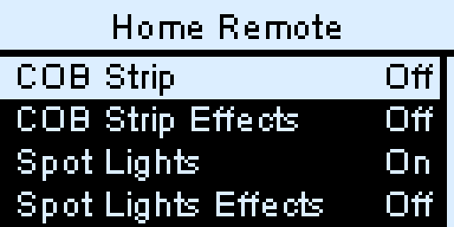
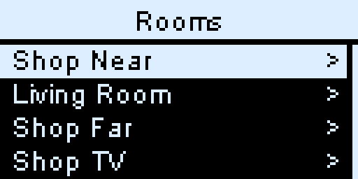
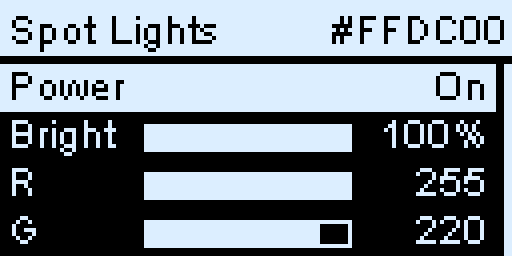
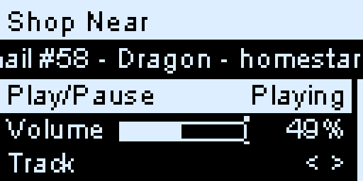
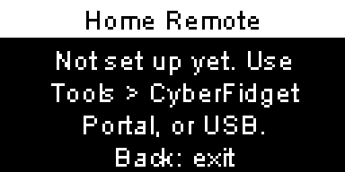

<!-- Cyber Fidget documentation - CC BY-SA 4.0 -->
# Home Remote

After this page you can control your Home Assistant lights and speakers from your Cyber Fidget. Turn a light on with one long press, set its brightness with the slider, pick a colour, or pause the music.

**Home Remote** is a built-in app (**Tools > Home Remote**). It talks to [Home Assistant](https://www.home-assistant.io/), the home-automation software many people run at home, over your home WiFi. It controls lights, speakers (Home Assistant calls them media players), scenes and scripts. In Home Assistant, a *scene* recalls saved settings for several devices at once, and a *script* runs a list of actions.

{ width="384" }

## What you need

- **Home Assistant on your home network**, at an address that starts with `http://`, such as `http://homeassistant.local:8123` (the usual one) or `http://192.168.1.20:8123`.
- **Your Fidget on the same WiFi.** Save your home network first with **Settings > Setup WiFi** (see [Setting up WiFi](web-portal.md#setting-up-wifi)).
- **An access key from Home Assistant** (Home Assistant calls it a *long-lived access token*). The steps below make one.

## Set it up

### 1. Make an access key in Home Assistant

1. Open Home Assistant and select your name at the bottom left to open your profile.
2. Open the **Security** tab, scroll to **Long-lived access tokens** and select **Create token**.
3. Name it `Cyber Fidget`, then copy the key. Home Assistant shows it only once.

Treat the key like a password: anyone who has it can control your Home Assistant.

### 2. Give it to your Fidget

1. On the Fidget, open **Tools > CyberFidget Portal** and open the portal on your phone or computer (see [Web Portal](web-portal.md)).
2. In the portal, open **Settings**, then **Network**, and scroll to the **Home Remote** card.
3. Check the **Home Assistant address**. It starts as `http://homeassistant.local:8123`; change it if your Home Assistant uses another address.
4. Paste the key into **Access key**.
5. Select **Test connection**. **Connected to Home Assistant.** means it works.
6. Select **Save**. The card says **Saved. Open Home Remote on your Cyber Fidget to use it.**
7. On the Fidget, press **Back**, then **Enter** to confirm **Exit portal?**. After it restarts, open **Tools > Home Remote**.

{ width="362" }

To change the address later without retyping the key, leave **Access key** empty and select **Save**: the saved key is kept.

| Test connection says | What to do |
|---|---|
| **Connected to Home Assistant.** | All set. Select **Save**. |
| **Home Assistant didn't accept that access key.** | Make a new key in Home Assistant and paste it again. |
| **Couldn't reach Home Assistant at that address.** | Check the address, and that your Fidget can reach Home Assistant on your home network. (Home Assistant itself can be on a cable.) |
| **Connect your Cyber Fidget to your home WiFi first (above).** | Choose your home network under **Available Networks**, enter its password and select **Connect**. **WiFi Connection** shows the result. |
| **Use an address that starts with http://, like http://homeassistant.local:8123.** | Home Remote only uses plain `http://` addresses on your home network. |
| **That access key doesn't look right. Copy it again from Home Assistant.** | The pasted text wasn't accepted. Copy it again, without extra spaces or line breaks. |
| **Couldn't check. Try again.** | The check couldn't finish. Check that the portal page is still connected, and try again. |

### 3. Choose what shows on the Fidget

Home Remote shows two things from Home Assistant:

- **Favorites** are the lights, speakers, scenes and scripts you give the label `cyber_fidget` in Home Assistant. Put the label on the **entity itself** (the light or speaker), not on its device or area: labels on a device or area don't count.
- **Rooms** are your Home Assistant **areas**. Every area with at least one light, speaker, scene or script appears, and opening it lists them.

To add the label in Home Assistant, open the entity's settings, add a label named `cyber_fidget` (create it the first time), and save. Favorites and each room show up to 32 items, sorted by name. **Rooms** shows up to 32 areas, in Home Assistant's order.

## Use it

### The buttons

| Button | What it does |
|---|---|
| **Up** / **Down** (top left / top right) | Move through the list. |
| **Left** / **Right** (middle left / middle right) | Change the selected setting. Hold to change faster. |
| **Enter** (bottom right) | Open or act on the selected row. **Hold** about a second on a list for a quick action. |
| **Back** (bottom left) | Go up one level. From the top screen, leave the app. |

### The top screen

Your favorites come first, each with its state on the right: **On** or **Off** for a light, **Playing**, **Paused**, **Idle** or **Off** for a speaker, and **Run** for a scene or script. A light or speaker that Home Assistant says isn't available shows **--**; trying an unavailable scene or script shows **Not available**. Below them are **Rooms** and **Status**.

- **Enter** on a light or speaker opens its screen. On a scene it runs the scene (**Scene on**); on a script it starts the script (**Script started**).
- **Hold Enter** for the quick action without opening anything: a light turns on or off, a speaker plays or pauses, a scene or script runs. This works on the top screen and inside a room.

{ width="384" }

### A light

{ width="384" }

| Row | What it does |
|---|---|
| **Power** | **Left** turns it off, **Right** turns it on, **Enter** switches it. |
| **Bright** | **Left** / **Right** change the brightness. Only for lights that dim. |
| **R**, **G**, **B** | **Left** / **Right** adjust red (**R**), green (**G**) and blue (**B**), from 0 to 255 each. Only for colour lights. |
| **Color** | **Left** / **Right** step through the presets (Warm white, Red, Orange, Yellow, Green, Cyan, Blue, Magenta) and apply each one straight away; **Enter** applies the shown preset again. |
| **Effect** | **Enter** opens the light's effects; pick one with **Enter**. Only for lights with effects. |

**The slider sets the brightness.** When you open a light, moving the slider changes nothing until it reaches the light's current brightness, so the light doesn't jump. A small marker on the bar shows where the slider is until then. Changing anything except turning it off also turns the light on.

### A speaker

{ width="384" }

The second line shows what's playing. The rows appear only when the speaker supports them:

| Row | What it does |
|---|---|
| **Play/Pause** | **Enter** plays or pauses. |
| **Volume** | **Left** / **Right** change it a step at a time. The slider sets it too, after it reaches the current volume. |
| **Track** | **Left** goes to the previous track, **Right** to the next. |
| **Mute** | **Enter** mutes or unmutes. |

### Status

**Status** shows whether Home Assistant answered, the **Mirror on LEDs** switch, the address, and the WiFi network the Fidget is on. To check the connection again, select the first row, marked **Check**, and press **Enter**.

### Mirror on LEDs

With **Mirror on LEDs** on, the Fidget's three front lights show the colour of the light you have open, dimmed, so you can see what you're picking. It also works in the light's Effect list. A light without colour shows warm white. The front lights go dark when the light is off or unavailable, after five minutes without use, or when you go back to another screen or leave the app. It's on to start with; switch it in **Status** (**Enter** on **Mirror on LEDs**).

## If something goes wrong

{ width="384" }

| The Fidget says | What it means |
|---|---|
| **Not set up yet. Use Tools > CyberFidget Portal, or USB.** | There's no address or key yet. [Set it up](#2-give-it-to-your-fidget). |
| **Set up WiFi first in Settings.** | No WiFi network is saved. Use **Settings > Setup WiFi**. |
| **Couldn't join WiFi.** | The saved network didn't answer. **Enter** tries again. |
| **Can't reach Home Assistant.** | The Fidget is on WiFi but Home Assistant didn't answer at the saved address. Check the address and that Home Assistant is running. **Enter** tries again. |
| **Home Assistant did not accept the access key.** | The key was deleted or mistyped. Make a new one and save it in the portal. |
| **Unexpected answer from Home Assistant.** | The server at that address gave an unexpected reply. Check the address and that Home Assistant is working. **Enter** tries again. |
| **WiFi is busy. Try again soon.** | Another part of the Fidget is using WiFi. Try again in a moment. |
| **Not enough memory. Restart and try again.** | Switch the Fidget off and on, then open Home Remote again. |

Once the lists have loaded, a connection problem or an unexpected reply shows as a short message at the bottom instead, such as **Can't reach Home Assistant**, and the app keeps going. A rejected access key still opens its full error screen.

## Good to know

- **Same home network only.** Home Remote reaches Home Assistant at an `http://` address on your home WiFi. Addresses that start with `https://`, including remote-access addresses, aren't used.
- **WiFi only while it's open.** The Fidget turns WiFi on when you open Home Remote and off when you leave. If Bluetooth is in use (for example after the Music Player), it says **Opening Home Remote...** and restarts straight into the app.
- **It stays awake while you use it.** On a light or speaker screen it stays awake for five minutes after you last touch it, then sleeps as usual.
- **The key stays private.** The Fidget doesn't show the access key on its screen, in the portal or over USB.

!!! advanced "Advanced: set it up over USB instead"

    You don't need this if you used the portal.

    The Fidget's [USB serial commands](../reference/serial-commands.md) can set the address and key from a computer. A key is longer than one command line, so it goes in pieces: `hr token` with the first part, then `hr token+` with the rest. The reply only says how many characters are saved.

    | Command | What it does |
    |---|---|
    | `hr url http://homeassistant.local:8123` | Saves the address. |
    | `hr token <first part>` then `hr token+ <next part>` | Saves the key in pieces: up to 150 characters with `hr token`, then up to 149 per `hr token+`. |
    | `hr mirror on` / `hr mirror off` | Switches Mirror on LEDs. |
    | `hr show` | Shows the address, whether a key is saved (`set` / `unset`) and the mirror setting. |
    | `hr clear` | Removes the address and key. |

    See [Serial commands](../reference/serial-commands.md) for the replies.

## See also

- [Web Portal](web-portal.md) - opening the portal and saving WiFi
- [Built-in apps](../software/apps.md) - every app on the Fidget
- [Home Assistant: long-lived access tokens](https://www.home-assistant.io/docs/authentication/) - Home Assistant's own help
