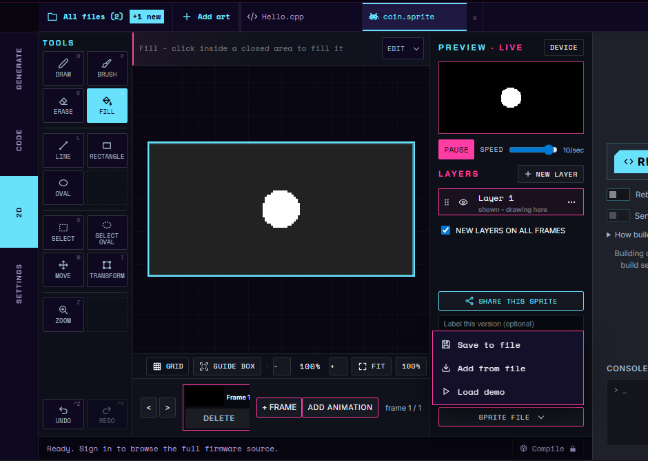
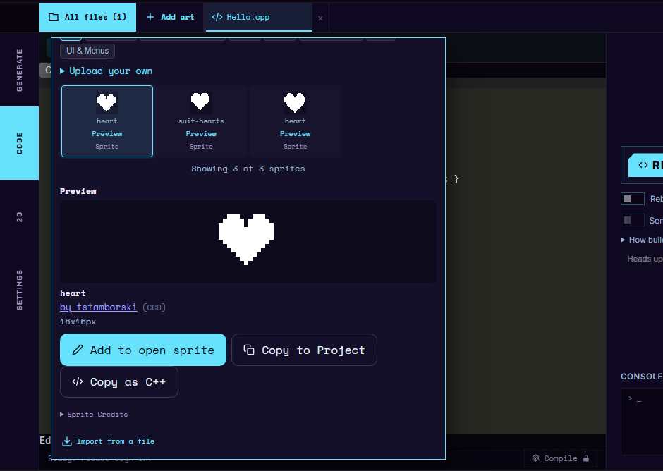

# Sprite assets in built-in apps

After this page you can add a sprite to a built-in app, put it where the build expects it, and keep the generated code in step with the drawing.

This page is for firmware contributors. If you are making an app in the studio, the studio does all of this for you: see [Sprites & Animation](../concepts/sprites.md).

---

## What is this?

A built-in app draws its pictures from **generated headers**. A generated header is a C++ file that a tool writes for you from a sprite drawing, so you never type the bitmap bytes by hand.

Each sprite has two files:

| File | Folder | You edit it? |
|---|---|---|
| The sprite drawing, `<name>.cfsprite.json` | `lib/<App>/assets/` | Yes. This is the source. |
| The generated header, `<name>.h` | `lib/<App>/generated/` | No. The tool writes it, and both files are committed. |

The Dino game is a real example. `lib/DinoGame/assets/` holds `cactus.cfsprite.json`, `dino.cfsprite.json`, `ground.cfsprite.json` and `pterodactyl.cfsprite.json`. `lib/DinoGame/generated/` holds the matching `cactus.h`, `dino.h`, `ground.h` and `pterodactyl.h`.

The first lines of every generated header say so: "Generated from .cfsprite.json. Edit the source asset, not this header."

---

## Step 1: author the sprite

Draw the sprite in the [studio](https://cyberfidget.com/create/)'s 2D tab. In a project, choose **Add art > Draw a new sprite**, type a name and choose **Create** (see [Sprites & Animation](../concepts/sprites.md) for the drawing tools).

When the drawing is done, open the **Sprite file** menu at the bottom of the right panel and choose **Save to file**. Your browser downloads the sprite as a `.cfsprite.json` file. You give it its final name in Step 2.

{ width="640" }

<video src="../../assets/media/firmware-sprite-save.webm" poster="../../assets/media/firmware-sprite-save.png" autoplay loop muted playsinline width="640"></video>

*Add art, Draw a new sprite, name it coin, draw and fill a circle, then Sprite file > Save to file.*

A `.cfsprite.json` file records the sprite's size, its pivot (the point placed at the screen position), its frames and its named animations. The Dino cactus is a good small file to read: one 8 by 16 frame and one looping animation called `idle`.

---

## Step 2: put it in the app's assets folder

Save the file as `lib/<App>/assets/<name>.cfsprite.json`. The build finds sprites with the pattern `lib/*/assets/*.cfsprite.json`, so the folder name and the ending both matter.

For an app called `MyApp` and a sprite called `coin`:

```text
lib/MyApp/assets/coin.cfsprite.json     <- you add this
lib/MyApp/generated/coin.h              <- the tool writes this
```

The part of the file name before `.cfsprite.json` is the **symbol prefix**. It becomes the C++ namespace the header defines. The compiler turns each run of characters other than letters, digits and `_` into one `_`, drops `_` from the start and the end, lowercases the result and puts `_` in front of a leading digit, so `Big Cactus 2` becomes `big_cactus_2`. A short lowercase name made of letters, digits and underscores keeps the namespace the same as the file name. The cactus file gives `cf::gfx::cactus`.

If two sprites would write to the same `generated/` file, the build stops with an "Asset header collision" error.

---

## Step 3: make the header

The header is written by the **sprite compiler**, the program that turns a drawing into C++. The compiler is part of the Cyber Fidget website. It is not in the firmware repository, and the studio doesn't save generated headers to a file. So how you make the header depends on whether you have the compiler.

### If you don't have the sprite compiler

Most contributors don't. Commit the `.cfsprite.json` from Step 2 and say in your pull request that the sprite's header needs generating, so it can be made with the compiler before the change goes in. Until the header exists, the build can't compile code that includes it.

You can still check the sprite before you send it: in a studio project, choose **Sprite file > Add from file** (the menu in Step 1) and draw the sprite from a test app, as [Sprites & Animation](../concepts/sprites.md) shows. A studio app turns the drawing into code with the same compiler, so the sprite looks and animates there as it will in the firmware.

!!! tip "A still picture without the compiler"
    A built-in app can also draw a still picture from an XBM bitmap, a plain array of bytes, with `display.drawXbm()` (see [Bitmaps](../concepts/display.md#bitmaps-drawxbm)). The studio's **Copy as C++** button copies a free starter sprite in that form: open **All files > Free starters**, choose **Preview** on a sprite, then **Copy as C++** (see [Option B on the Sprites page](../concepts/sprites.md#option-b-copy-a-free-starter)). It only covers the free starters, the picture has no animation, and the drift check below doesn't cover it.

    { width="480" }

### If you have the sprite compiler

This is for firmware developers who also have the Cyber Fidget website source. Run the `cfsprite-regen` target from the firmware folder. A **PlatformIO target** is a named extra job you run with `-t`. This one rewrites every generated header from its drawing:

```bash
pio run -t cfsprite-regen
```

It prints one line per file, for example `Generated lib/DinoGame/generated/cactus.h` (on Windows the path uses backslashes). Commit the new or changed `.h` next to the `.cfsprite.json`.

The target needs two things on your computer:

- **Node.js**, the JavaScript runtime that runs the tool. Without it the target stops with "Node.js is required to compile .cfsprite assets".
- **The sprite compiler.** The tool looks for it in a folder named `cyberfidget_website` next to the firmware folder (`assets/js/cfsprite_compile.mjs`). If yours is somewhere else, set the `CF_CFSPRITE_COMPILER` environment variable to its full path.

If the compiler cannot be found, regeneration fails on purpose rather than skipping, with "Could not find the .cfsprite compiler".

---

## Step 4: use the sprite in your app

Include the header and point an actor at the sheet. The Dino game does this in `lib/DinoGame/DinoGame.h` with `#include "generated/dino.h"`, and in `lib/DinoGame/DinoGame.cpp` with:

<!-- check-examples: skip - firmware source excerpt, not a studio app -->
```cpp
dinoActor.setSheet(&cf::gfx::dino::sheet);
dinoActor.play(cf::gfx::dino::anim_run, millis());
```

`sheet` is the whole set of animations. Each animation also gets a name of the form `anim_<animation name>`.

---

## The drift check

**Drift** means a generated header no longer matches the drawing it came from, usually because someone edited the drawing and forgot to regenerate. The **drift check** catches this.

It runs automatically near the end of every firmware build (`pio run`, including `pio run -e local`), after the code has compiled. For each sprite it asks the compiler to produce the header again and compares the result with the committed file. Line endings are ignored, so a Windows checkout does not cause false alarms.

If a header has drifted, the build fails with:

```text
cfsprite_compile_cli: Generated header drift: lib/DinoGame/generated/cactus.h
Regenerate target: pio run -t cfsprite-regen
```

Run the regenerate step above, then commit the updated header.

With the compiler, you can also run the check by hand for one sprite, from the firmware folder. It prints `Checked lib/DinoGame/generated/cactus.h` when the header matches:

```bash
node tools/cfsprite_compile_cli.mjs --check-only --symbol-prefix cactus lib/DinoGame/assets/cactus.cfsprite.json lib/DinoGame/generated/cactus.h
```

!!! note "The check can be skipped"
    If Node.js or the sprite compiler is missing, the build prints `cfsprite_assets: WARNING - asset drift check SKIPPED` and carries on, because the committed headers already compile. The automated build on GitHub does not have the compiler, so it skips the check. If you have the compiler, run the build on your own computer before you commit sprite changes.

---

## Framework details

!!! advanced "Advanced: 3D models and the files behind the build step"
    You do not need these details to add a sprite. They cover the other kind of asset and the files that run the steps above.

    - The same build hook also handles 3D models: `.cfmesh.json` files in `lib/<App>/assets/` become headers in `lib/<App>/generated/`, regenerated with `pio run -t cfmesh-regen`. It uses the model compiler, `cfmesh_compile.mjs`, from the same website folder, or the path in the `CF_CFMESH_COMPILER` environment variable. See [3D Models](../studio/3d-models.md) and the [3D model file format](../reference/cfmesh-format.md).
    - `tools/legacy_xbm_to_cfsprite.mjs` converted the Dino game's older hand-written XBM bitmap arrays in `lib/DinoGame/DinoSprites.h` into its `.cfsprite.json` files. It reads only that file, so treat it as an example to adapt rather than a general converter.
    - The hook is `scripts/cfsprite_assets.py`, listed under `extra_scripts` in `platformio.ini`. The command-line compiler wrappers are `tools/cfsprite_compile_cli.mjs` and `tools/cfmesh_compile_cli.mjs`. `node tools/cfsprite_compile_cli.mjs --help` prints its usage: `[--check-only] [--symbol-prefix NAME] INPUT OUTPUT`.

See also: [Firmware development](index.md) and [How an App Works](../concepts/app-lifecycle.md).
