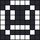
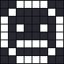
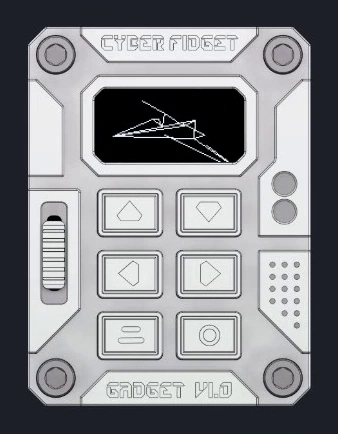

# Explore what it can do

After this page you will know what each part of a Cyber Fidget can do, and you will have seen a few lines of code that make each part do something. You don't need a plan or a device: every example runs in the emulator in your browser.

<video src="../../assets/media/emulator-catcher.webm" poster="../../assets/media/emulator-catcher.png" autoplay loop muted playsinline width="260"></video>

*A small game made from the parts on this page: the slider moves the paddle, the screen shows the score, and the lights and speaker react when you catch a dot.*

## How to try an example

1. Open the studio at [cyberfidget.com/create/](https://cyberfidget.com/create/) and start from **Code from Blank Template**. Steps 1 and 2 of [Build your first app](first-app.md) show where the buttons are.
2. Each example's first line says where it goes in the `.cpp` file, for example "Insert inside update(), just above display.display();". `update()` is the part of the app that runs about 50 times a second.
3. Press **REBUILD & RUN** (the first time) or **REBUILD** (after that) to see it run.

Each example works on its own, in a fresh starter. Stuck? Open the **Full code for this step** box under an example: it shows the whole file with the new lines highlighted.

Jump to a part: [screen](#the-screen) | [buttons](#the-buttons) | [lights](#the-lights) | [sound](#sound) | [slider](#the-slider) | [motion](#motion) | [sprites and animation](#sprites-and-animation) | [3D models](#3d-models)

---

## The screen

A 128 x 64 pixel screen (an OLED, so each pixel lights up on its own). You can draw text, lines, rectangles, circles and pictures, and redraw everything about 50 times a second, which is how things move.

```cpp
// Insert inside update(), just above display.display();
// Wipe the starter's text so the screen is empty.
display.clear();
display.setFont(ArialMT_Plain_10);
display.drawString(64, 10, "Hello, Fidget!");
// millis() is the time in milliseconds since the Fidget started.
// % 128 is the remainder after dividing by 128, so x runs 0 to 127, then starts again.
int x = (millis() / 10) % 128;
// A filled circle with its middle at (x, 40) and a radius of 6 pixels.
display.fillCircle(x, 40, 6);
```

**What you'll see:** a greeting at the top and a ball that slides across the screen, again and again.

More: [Drawing to the Screen](../concepts/display.md).

---

## The buttons

Six buttons: up, down, left, right, Back (bottom left) and Enter (bottom right). Your app can check whether a button is down at any moment, or ask to be told the moment it is pressed.

```cpp
// Insert inside update(), just above display.display();
display.clear();
// isPressed() is true while the button is held down.
// button_EnterIndex is the bottom-right button.
if (buttonManager.isPressed(button_EnterIndex)) {
    display.drawString(64, 24, "Pressed!");
    HAL::setRgbLed(pixel_Front_Bottom, 0, 255, 0, 0);
} else {
    display.drawString(64, 24, "Hold Enter");
    HAL::setRgbLed(pixel_Front_Bottom, 0, 0, 0, 0);
}
```

**What you'll see:** "Hold Enter" on the screen. Hold the bottom-right button and the text changes and the bottom light turns green.

More: [Buttons & Events](../concepts/buttons.md).

---

## The lights

Four color lights (LEDs): three on the front and one on the back. Each one mixes red, green, blue and white, from 0 (off) to 255 (full).

```cpp
// Insert inside update(), just above display.display();
// A hue from 0 to 4095 walks once around the rainbow.
int hue = millis() % 4096;
// uint8_t is a whole number from 0 to 255: one color channel.
uint8_t r;
uint8_t g;
uint8_t b;
// mapToRainbow() turns the hue into red, green and blue at brightness 128,
// and writes them into r, g and b.
mapToRainbow(hue, 128, r, g, b);
setDeterminedColorsAll(r, g, b, 0);
```

**What you'll see:** all four lights fade slowly through the rainbow, one lap about every 4 seconds.

More: [LEDs & Color](../concepts/leds.md).

---

## Sound

A small speaker that plays tones, little tunes and chords. You give each tone a pitch in hertz (Hz, vibrations per second: higher is a higher note) and a length in milliseconds.

```cpp
// Insert inside begin(), below setColorsOff();
// A short tune. Each step is: pitch in Hz, length in ms, pause after it in ms.
static const AudioManager::ToneStep tune[] = {
    { 523.25f, 120, 30 },  // C5
    { 659.25f, 120, 30 },  // E5
    { 783.99f, 120, 30 },  // G5
    { 1046.50f, 300, 0 },  // C6
};
HAL::audioManager().playSequence(tune, 4);

// Insert inside end(), above unregisterButtonCallbacks();
// Stop any sound when the app closes.
HAL::audioManager().stopSequence();
HAL::audioManager().stopTone();
```

**What you'll see (and hear):** a rising four-note jingle each time the app starts. Press **<< RESTART** in the emulator to hear it again.

More: [Sound & Music](../concepts/audio.md).

---

## The slider

The slider on the side reads a position from bottom to top. Use it as a dial: for volume, brightness, speed, or to steer something.

```cpp
// Insert inside update(), just above display.display();
// 0 with the slider at the bottom, 255 at the top.
int level = sliderPosition_8Bits_Inverted_Filtered;
display.clear();
// An empty box, then a bar inside it that grows as you push the slider up.
display.drawRect(10, 28, 108, 8);
display.fillRect(10, 28, level * 108 / 255, 8);
// The front top light glows white, brighter as the slider goes up.
HAL::setRgbLed(pixel_Front_Top, 0, 0, 0, level);
```

**What you'll see:** a bar that fills as you drag the slider up, and the top light getting brighter with it.

More: [The Slider](../concepts/slider.md).

---

## Motion

A motion sensor (an accelerometer) feels which way is down, so your app can react when you tilt or shake the Cyber Fidget. In the emulator, use its tilt controls.

```cpp
// Insert inside update(), just above display.display();
// accelX and accelY are near 0 when the Fidget lies flat,
// and grow (up to about 1000) as you tilt it.
int dotX = 64 - (int)(accelX / 40);
int dotY = 32 + (int)(accelY / 40);
// constrain() keeps a number between a lowest and a highest value,
// so the dot stays on the screen.
dotX = constrain(dotX, 12, 116);
dotY = constrain(dotY, 12, 52);
display.clear();
display.drawCircle(64, 32, 4);
display.fillCircle(dotX, dotY, 5);
```

**What you'll see:** a dot that rolls away from the small middle circle as you tilt, like the bubble in a spirit level.

More: [Motion Sensing](../concepts/accelerometer.md).

---

## Sprites and animation

A sprite is a small picture for a character or object. An animation shows several sprites one after another. Draw sprites in the studio, or try the blinking face below.

{ .no-lightbox width="81" } { .no-lightbox width="81" }

??? example "Try it"

    ```cpp
    // Insert at the top of the file, below the #include lines
    #include "cf_gfx.h"
    using namespace cf::gfx;
    // Two 8 x 8 faces. Each byte is one row of pixels, top to bottom.
    static const uint8_t openBits[] = {0x3c, 0x42, 0xa5, 0xa5, 0x81, 0xbd, 0x42, 0x3c};
    static const uint8_t shutBits[] = {0x3c, 0x42, 0x81, 0xa5, 0x81, 0xbd, 0x42, 0x3c};
    // bytes, width, height, pivot x, pivot y, bit order
    static const Sprite eyesOpen = {openBits, 8, 8, 4, 8, BO_LSB_FIRST};
    static const Sprite eyesShut = {shutBits, 8, 8, 4, 8, BO_LSB_FIRST};
    // The frames in order, and how long each one shows in milliseconds.
    static const Sprite* const blinkFrames[] = {&eyesOpen, &eyesShut};
    static const uint16_t blinkTimes[] = {1500, 150};
    static const Animation blink = {"blink", blinkFrames, blinkTimes, 0, 2, LOOP_LOOP};
    static AnimationPlayer blinker;

    // Insert inside begin(), below setColorsOff();
    blinker.play(&blink, millis());

    // Insert inside update(), just above display.display();
    display.clear();
    blinker.update(millis());
    const Sprite* frame = blinker.sprite();
    if (frame != nullptr) {
        drawSpritePivoted(display, *frame, 64, 40);
    }
    ```

    The sprites page explains `*`, `&` and `nullptr` one at a time, and shows how to draw your own sprites in the studio instead of typing bytes.

**What you'll see:** a small face in the middle of the screen that blinks about every one and a half seconds.

More: [Sprites & Animation](../concepts/sprites.md), and for artists, the [Studio overview](../studio/overview.md).

---

## 3D models

The screen can show spinning 3D wireframe models: shapes made of points joined by straight lines. Everyone can use the Studio's **3D** tab to draw a model or [import an OBJ or STL file](../studio/3d-models.md#importing-a-model-file). The example in **Try it** spins a box, described by its 8 corners and 12 edges. The picture shows a model drawn in the studio, running the same way.

{ width="180" }

??? example "Try it"

    ```cpp
    // Insert at the top of the file, below the #include lines
    #include "cf_gfx.h"
    using namespace cf::gfx;
    // The 8 corners of a box. Each corner is {x, y, z}.
    static const MeshVertex boxPoints[] = {
        {-8, -8, -8}, {8, -8, -8}, {8, 8, -8}, {-8, 8, -8},
        {-8, -8, 8},  {8, -8, 8},  {8, 8, 8},  {-8, 8, 8},
    };
    // The 12 edges. Each edge joins two corners, by their number in boxPoints.
    static const uint8_t boxLines[][2] = {
        {0, 1}, {1, 2}, {2, 3}, {3, 0},
        {4, 5}, {5, 6}, {6, 7}, {7, 4},
        {0, 4}, {1, 5}, {2, 6}, {3, 7},
    };
    // name, points, point count, lines, line count
    static const Mesh boxMesh = {"box", boxPoints, 8, boxLines, 12};
    static MeshActor boxModel;

    // Insert inside begin(), below setColorsOff();
    boxModel.setMesh(&boxMesh);
    boxModel.setPos(64, 32);
    boxModel.setRotation(0, 24, 0);

    // Insert inside update(), just above display.display();
    // Turn the box a little more every frame.
    boxModel.spin(1, 0, 0);
    display.clear();
    boxModel.draw(display);
    ```

**What you'll see:** a wireframe box spinning in the middle of the screen.

More: [3D Models](../concepts/3d-models.md), and to build models without typing numbers, [3D Models in the studio](../studio/3d-models.md).

---

## Got an idea?

- **Make a game:** [Make a game, step by step](make-a-game.md) builds the game in the clip above, and helps you plan your own.
- **Start small:** [Build your first app](first-app.md) walks through the studio from the very first click and ends with your app on a real Cyber Fidget.
- **Look something up:** the [function reference](../reference/functions.md) lists everything your app can call, on one page.
