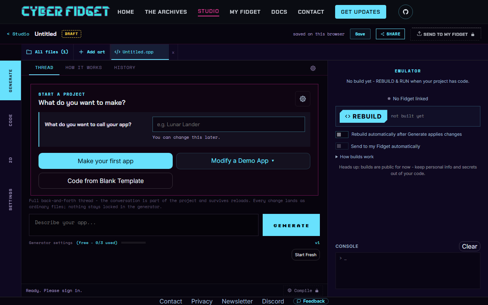
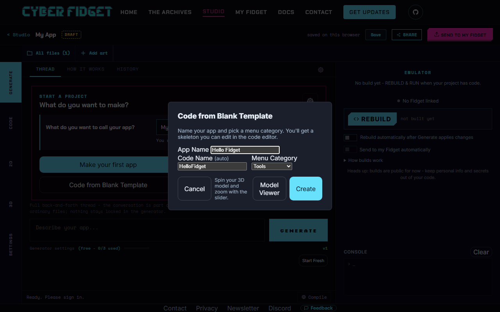
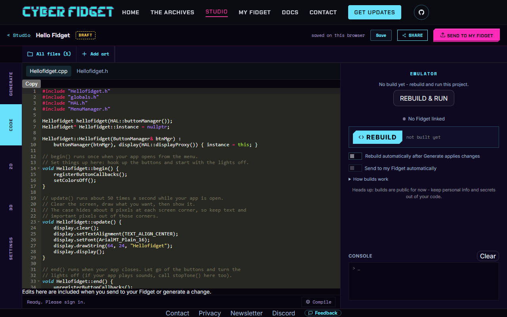
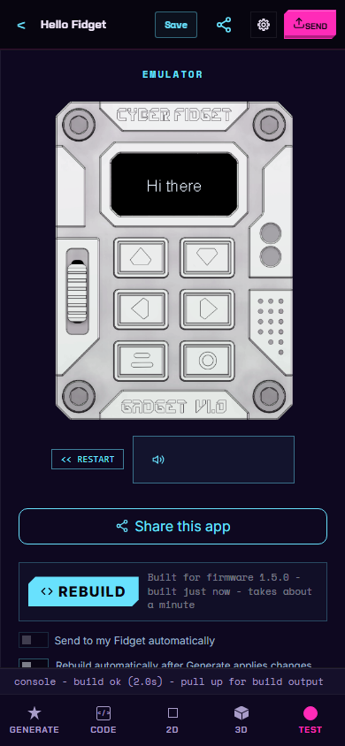
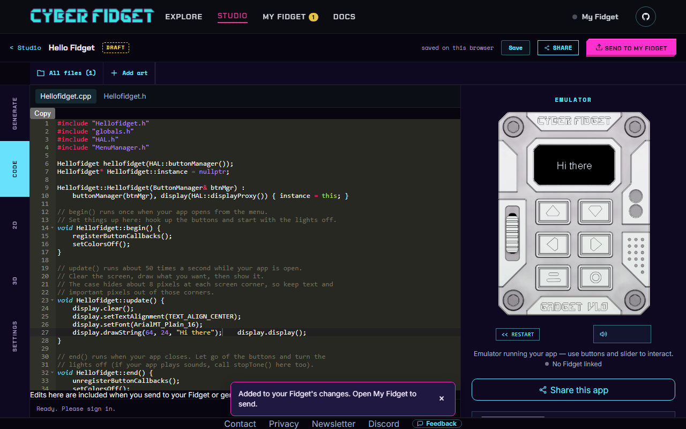
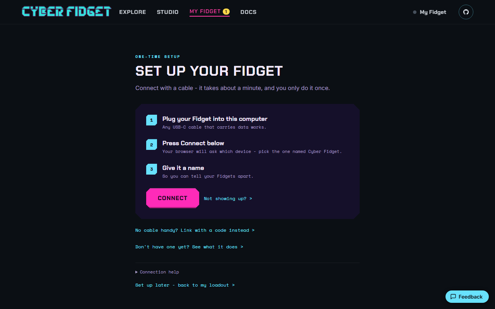

# Build your first app in the browser

By the end of this page you will have written a small app, watched it run, and (if you have a Cyber Fidget handy) installed it on your device. There is nothing for you to install. You write and test in the browser; the studio builds on your computer when available, or uses its build server.

!!! note "What you need"
    - A computer with Chrome, Edge or Firefox, and an internet connection.
    - About 15 minutes.
    - For the last step only: a Cyber Fidget and a USB-C cable that carries data (not a charge-only cable).

    You do not need a Cyber Fidget to do steps 1 to 6. The emulator is a copy of the device that runs on the page.

---

## 1. Open the studio

Go to [cyberfidget.com/create/](https://cyberfidget.com/create/). (On the home page, the button is **Open the Studio**.)

Press **+ Create an app**. The studio opens a workspace with a panel called "Start a project".



---

## 2. Start from the blank template

Press **Code from Blank Template**. A box opens with three choices:

- **App Name**: the name you see in the studio.
- **Code Name**: filled in for you. It becomes the file names and the class name in your code, and it is the text the starter app draws on the screen.
- **Menu Category**: where your app will sit in the device's menu. The default is **Tools**. You can also pick Screensavers, Games, Examples or Media.

Pick a one-word App Name, such as `Hello`. Short names give short, predictable code names. If you type two words, the studio joins them and changes some capital letters (for example "Hello Fidget" gives a code name that starts `Hellofidget`), so the text on the screen may not match what you typed.



Press **Create**.

---

## 3. Look at the starter code

The studio jumps to the **CODE** tab. You will see two files: a `.cpp` file (the app's code) and a `.h` file (a short list of what the app contains). Everything you need is in the `.cpp` file.



Every app has three functions. The comments in the starter explain them too.

| Function | When it runs |
|----------|--------------|
| `begin()` | Once, when the app opens from the menu. Set things up here. |
| `update()` | About 50 times a second while the app is open. Draw the screen here. |
| `end()` | Once, when the app closes. Tidy up here. |

See [How an App Works](../concepts/app-lifecycle.md) for more.

Inside these functions two things are ready to use:

- `display` draws on the screen (the OLED, the 128 x 64 pixel display).
- `buttonManager` lets your app react to button presses.

The starter already hooks up the bottom-left button to close your app and return to the menu. Leave that as it is, so you can always get out.

---

## 4. Change something

Find the line in `update()` that draws the text. It looks like this, with your own code name between the quote marks:

<!-- check-examples: skip - a line to find and edit in the starter, not code to add -->
```cpp
display.drawString(64, 24, "Hello");
```

Change the text between the quote marks to anything you like, for example `Hi there`. Keep the quote marks. Short text fits best: the screen is small, and the case hides about 8 pixels in each corner.

---

## 5. Rebuild and run

!!! warning "Keep private information out of code"
    Builds on your computer keep your code on your computer. If the studio uses the build server instead, that build is public. Keep personal information and secrets out of your code either way.

Press **REBUILD & RUN** in the welcome panel on the right, or **REBUILD** in the emulator panel.

The studio compiles your code (turns it into a program the emulator can run). When building on your computer is available, the first build downloads about 23 MB of build tools, so it takes longer. Later builds on the computer can take a few seconds. If the computer cannot build, or building there is unavailable, the studio uses its build server; allow more time. When it succeeds, your app starts in the emulator.

Builds sent to the build server have a daily limit. Builds done on your own computer do not count toward it.

On a phone, the emulator is on the **TEST** tab at the bottom of the screen. The welcome action is **REBUILD & RUN**; the panel's build button is **REBUILD**. After editing code, press **REBUILD** to run your changes.



Try it:

- Click the buttons and drag the slider in the picture, or use the keyboard keys listed in the [emulator guide](../software/emulator.md).
- Press the bottom-left button to leave your app. **<< RESTART** starts it again.

!!! note "Two things you can ignore"
    The **Compile** button with a lock in the bottom status bar, and the "Ready. Please sign in." text next to it, are not needed for anything on this page. The emulator panel's **REBUILD** button does the work.

---

## 6. Add a light and a sound

Two short additions. Add each block where its first comment says. Rebuild and run after each one.

The Cyber Fidget has four [RGBW](../reference/glossary.md) LEDs: red, green, blue and white, each from 0 (off) to 255 (full).

### A light you control with the slider

The slider reports a number from 0 to 255. On the device, the inverted value used here is low at the bottom and high at the top, so moving the slider up makes the blue lights brighter.

```cpp
// Insert inside update(), just above display.display();
setDeterminedColorsAll(0, 0, sliderPosition_8Bits_Inverted_Filtered, 0);
```

The arguments are red, green, blue, white. Drag the slider in the emulator and the LEDs change. Want a different color? Change which argument gets the slider value. More in [LEDs & Color](../concepts/leds.md) and [The Slider](../concepts/slider.md).

### A button that beeps

The six buttons are numbered like this:

| Position | Label in the emulator | Name in code |
|----------|-----------------------|--------------|
| Top left | Top Left - Up | `button_TopLeftIndex` |
| Top right | Top Right - Down | `button_TopRightIndex` |
| Middle left | Middle Left - Left | `button_MiddleLeftIndex` |
| Middle right | Middle Right - Right | `button_MiddleRightIndex` |
| Bottom left | Bottom Left - Back | `button_BottomLeftIndex` (the starter uses this one to go back to the menu) |
| Bottom right | Bottom Right - Select | `button_BottomRightIndex` |

This block has three parts, and each part says where it goes. A "callback" is a function the device calls for you when something happens, here a button press.

In `const ButtonEvent& e`, `&` passes the existing event by reference rather than making a copy; `const` means this function cannot change it.

```cpp
// Insert at the top of the file, below the #include lines
static void onRightPressed(const ButtonEvent& e) {
    if (e.eventType == ButtonEvent_Pressed) {
        HAL::audioManager().playTone(880, 100);
    }
}

// Insert inside begin(), below setColorsOff();
buttonManager.registerCallback(button_MiddleRightIndex, onRightPressed);

// Insert inside end(), above unregisterButtonCallbacks();
buttonManager.unregisterCallback(button_MiddleRightIndex);
HAL::audioManager().stopTone();
```

Add the first section below the `#include` lines and above the line that creates the app object. Add the `begin()` section below its existing `setColorsOff();` line, and the `end()` section above its existing `unregisterButtonCallbacks();` line. The middle-right button plays a short beep (880 Hz, for 100 milliseconds). The `end()` lines let go of the button and stop any sound when your app closes. See [Buttons & Events](../concepts/buttons.md) and [Sound & Music](../concepts/audio.md).

Looking for more functions to try? See the [function reference](../reference/functions.md).

---

## 7. Install it on your Cyber Fidget

!!! note "Optional"
    You only need this step if you have a Cyber Fidget. You can skip it and keep playing in the emulator. Installing over the cable needs no account and no sign-in.

1. Press **SEND TO MY FIDGET** at the top right of the studio. This adds your app to your Fidget's list of changes. It does not install it yet. A message says "Added to your Fidget's changes. Open My Fidget to send." (If you have not built the app yet, it asks you to build first.)

    

2. Open **MY FIDGET** from the top bar. The first time, you see **Set up your Fidget**, a one-time setup:

    

    1. Plug your Fidget into the computer with a USB-C cable that carries data. Press **Connect**. Your browser shows a list of devices: pick **Cyber Fidget**. (No **Connect** button? See "If there is no Connect button" below these steps.)
    2. Follow any firmware check or update instructions the page shows.
    3. If asked "This browser has apps saved from before. Use them with this Fidget?", press **Use them** to assign those saved apps and changes to this device. **Not now** leaves them saved in the browser without assigning them.
    4. Queued changes can be sent automatically during setup while you name your Fidget. Keep the cable plugged in and check the send report. Enter a name and press **Save name**, or press **Skip** to keep the suggested name.
    5. Sign-in is optional. Press **Skip** if you only want to use the cable. Signing in lets you continue with WiFi setup and linking for cable-free changes; see [Link your Fidget](../software/link-your-fidget.md).
    6. Press **See my Loadout** to return to your app list. A loadout is the collection of apps and menu choices for your Fidget.

3. If changes are still waiting, press **Send to my Fidget**. The page counts up as it sends ("Sending... 1 of 1"). Keep the cable plugged in until sending finishes. Read the report; if it offers **Try again**, use that to retry the send.

4. On the device, open your app from the menu. It is in the Menu Category you picked in step 2 (the default is Tools). Press the bottom-left button to go back to the menu.

!!! note "If there is no Connect button"
    When this browser cannot connect over USB, setup offers **Link with a code >** and instructions to set up WiFi from the Fidget's own screen. For the cable route, open the page on a computer with Chrome, Edge or Firefox that supports connecting over USB. For the WiFi route, follow [Link your Fidget](../software/link-your-fidget.md); it needs an account.

!!! tip "Optional extra: updates over WiFi"
    You can also link your Fidget to your account. Once it has saved a WiFi network, it can pick up your changes without a cable. See [Link your Fidget](../software/link-your-fidget.md).

---

## If something goes wrong

- **A typo.** The studio shows the compiler's error message in a box. Read the first error line. It names the line number in your file. Fix that line, then press **REBUILD** again.
- **Your Fidget is not in the browser's list.** The most common cause is a charge-only cable. Try another USB-C cable. The setup page also has a **Not showing up?** link with more help.
- **Did I lose my work?** **Save** keeps your project in this browser. The studio shows "saved on this browser" when it has.
- **Stuck on the emulator?** See the troubleshooting section of the [emulator guide](../software/emulator.md).

---

## Next steps

- [Function reference](../reference/functions.md): the functions you can call, on one page.
- The concept pages: [buttons](../concepts/buttons.md), [the screen](../concepts/display.md), [sound](../concepts/audio.md), [LEDs](../concepts/leds.md), [the slider](../concepts/slider.md) and [motion sensing](../concepts/accelerometer.md).
- Learn from real apps: in the studio's start panel, **Modify a Demo App** loads one of 16 demos (Spaceship, Dino Run, Breakout and more) that you can read, change and rebuild.
- Make your own pictures and animations: [Studio overview](../studio/overview.md).
- Optional: the studio's [code generator](../software/code-generator.md) can explain how an app works, or draft a change you then read and finish yourself.
- Want full control of the firmware? The [Arduino route](first-flash-arduino.md) is the advanced path.
