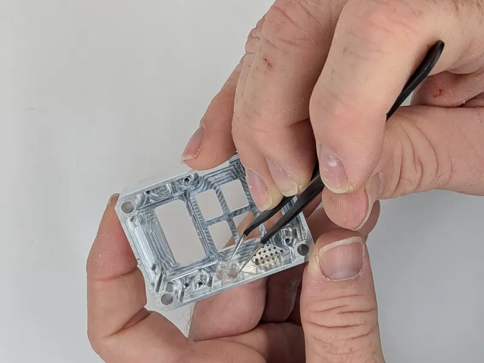
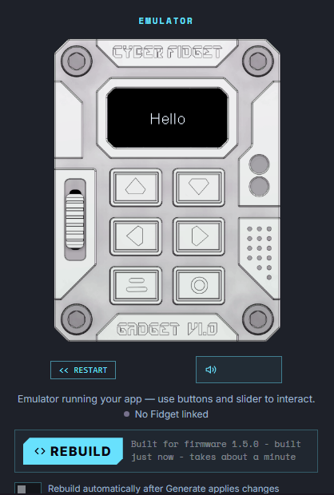

# Overview

{ width="320" height="320" }

<strong>From a box of parts to your own app running on the device.</strong>

Cyber Fidget ships as a high-quality kit -- no soldering required, just screws. By the end of this section you will have built your device and run your own app on it. The quickest route needs nothing installed: you write and test apps in your browser.

[Assembly guide](assembly/guide.md){ .md-button .md-button--primary }
[Build your first app](first-app.md){ .md-button }

-   { loading=lazy width="800" height="600" }

    **1. Put it together**

    ---

    About 15 minutes with a small screwdriver, with a photo for every step.

    [Assembly guide](assembly/guide.md)

-   { .cf-contain loading=lazy width="300" height="400" }

    **2. Explore what it can do**

    ---

    Each part of the device -- screen, buttons, lights, sound, slider, motion -- with a few lines of code to try.

    [Explore what it can do](explore.md)

-   { .cf-contain loading=lazy width="418" height="620" }

    **3. Build your first app**

    ---

    Write a small app in your browser, watch it run in the emulator, and send it to your device.

    [Build your first app](first-app.md)

-   { .cf-contain loading=lazy width="300" height="400" }

    **4. Make a game, step by step**

    ---

    A paddle game with lights, sound and a score, built one step at a time.

    [Make a game](make-a-game.md)

---

## What you'll need

- **USB-C cable** (data-capable, not charge-only)
- **Computer** with a USB port (Windows, macOS, or Linux). For the browser route, use Chrome, Edge or Firefox.
- **Small Phillips screwdriver** (for assembly)
- **microSD card** (FAT32 formatted, optional but recommended)
- **Internet connection** (for the browser tools, firmware and downloads)

---

## Steps

### 1. Assemble your device

Follow the [Assembly Guide](assembly/guide.md) to put your Cyber Fidget together. Every screw and part is accessible -- the enclosure is designed to be opened, explored, and modified.

### 2. Turn it on and find your way around

Near the end of assembly you flip the battery switch on the board to **On** ([Assembly step 9](assembly/guide.md#step-9-install-battery)), and the screen lights up: a short start-up animation, then the menu. The menu is grouped into categories such as Games and Tools.

| Button | In the menu |
|--------|-------------|
| Top left | Move up |
| Top right | Move down |
| Bottom right (Enter) | Open the highlighted item |
| Bottom left (Back) | Go back; inside most apps, return to the menu |

After about a minute without interaction (pressing a button or moving the slider), when running on battery, it goes to sleep to save power. Press the bottom-right button to wake it. Charge it with a USB-C cable. More in [Battery and Power](../product/battery-and-power.md).

### 3. Explore built-in apps

The firmware ships with 29+ built-in apps: games, screensavers, tools, and code examples. See the [Apps](../software/apps.md) page for the full catalog and each app's controls.

### 4. Build your first app in the browser

Write a small app, watch it run in the on-screen emulator, and send it to your device. Nothing to install. Follow [Build your first app in the browser](first-app.md). You can do most of it before your kit even arrives. To see what each part of the device can do first, with a few lines of code for each, read [Explore what it can do](explore.md).

### 5. Go further

Build bigger apps with the [App Builder](https://cyberfidget.com/create/), or work on the firmware itself (see the advanced route below).

---

## Advanced: develop the firmware

Most people never need this. If you want to change the firmware itself, or build with your own toolchain, connect via USB-C and flash the firmware. See [Advanced: firmware with Arduino](first-flash-arduino.md) for step-by-step instructions.

!!! tip "Recommended toolchain"
    **VS Code + PlatformIO** (via pioarduino) gives the best experience -- automatic dependency management, built-in serial monitor, and one-click upload.

### Development options

| Toolchain | Notes |
|-----------|-------|
| **VS Code + PlatformIO** | Recommended. Uses pioarduino (community-maintained ESP32 platform) |
| **pioarduino IDE** | Standalone PlatformIO-compatible IDE |
| **Arduino IDE** | Works, but requires manual library management |
| **CircuitPython** | Hardware support designed-in but currently untested |

---

## Where to go next

- **[Explore what it can do](explore.md)** -- Each part of the device, with a few lines of code to try
- **[Build your first app](first-app.md)** -- Write and run an app in your browser
- **[Assembly Guide](assembly/guide.md)** -- Build your device step by step
- **[Advanced: firmware with Arduino](first-flash-arduino.md)** -- Flash firmware for the first time
- **[Concepts](../concepts/index.md)** -- Learn how apps use buttons, display, audio, LEDs, and more
- **[Hardware Specs](../hardware/specs.md)** -- Full component list and dimensions
