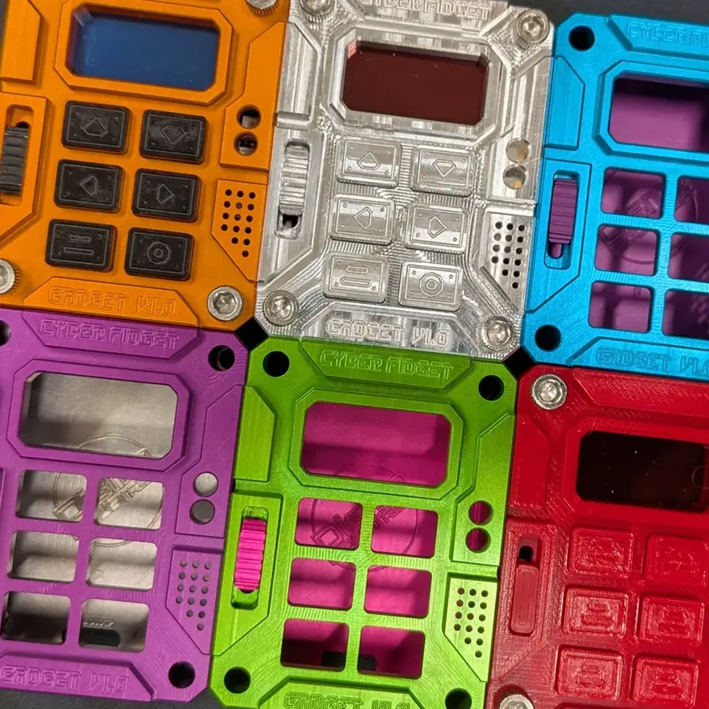
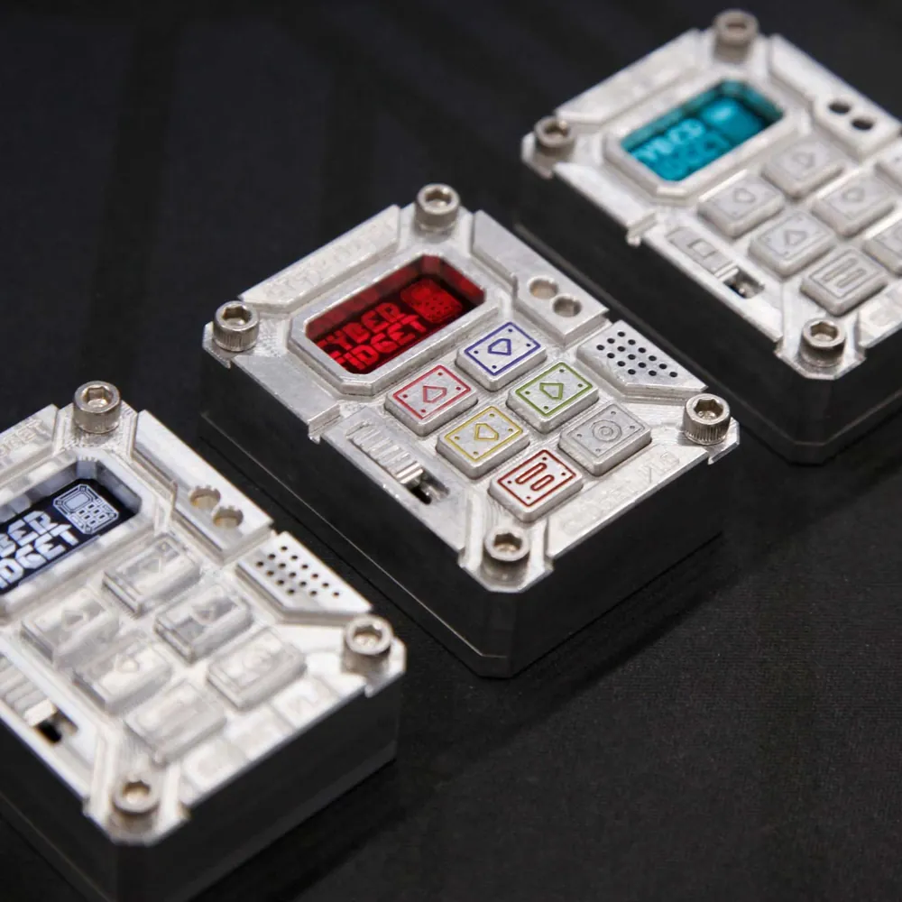
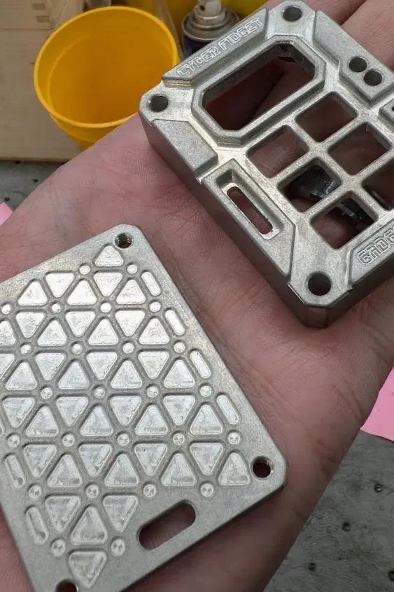
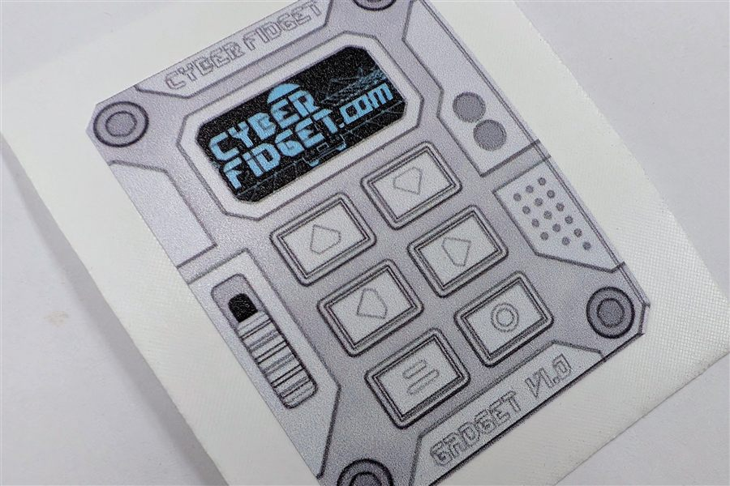

# Accessories

{ .no-lightbox width="320" height="320" }

<strong>Cyber Fidget is designed for customization. Swap parts, change colors, and make it yours.</strong>

After this page you know what you can change: the screen color filter, the backplate, parts you 3D print yourself, the case finish, and stickers.

---

## Color filters

{ loading=lazy width="1000" height="1000" }

A thin color filter sits in the case front, over the screen window, and changes the color the screen glows. You pick one when you build your Cyber Fidget.

Available colors include:

- **Red** -- warm, saturated glow
- **Teal** -- cool accent tone
- **Blue** -- cool accent tone

The filter goes in before the mainboard ([Assembly step 5](../getting-started/assembly/guide.md#step-5-install-color-filter)), so changing it later means opening the case and lifting the mainboard out.

---

## Backplates

{ loading=lazy width="563" height="845" }

Your Cyber Fidget comes with a machined aluminum backplate. It attaches with the main case screws and can be swapped, so you can replace it with one you design and 3D print yourself (see below).

---

## 3D printing

You can design and 3D print your own backplates, cases, or modifications. The enclosure's 3D model files aren't publicly available yet.

!!! tip "Design your own"
    The aluminum chassis dimensions are documented in the [Hardware Specs](../hardware/specs.md). Use these as reference when designing custom parts.

---

## Finish the case

You can change how the case looks:

- **Buff or tumble it** for a brighter or more even finish, if you have the bare machined-aluminum case.
- **Fill the engravings** with paint pens in colors of your choice.

---

## Stickers

{ loading=lazy width="900" height="600" }

Cyber Fidget stickers are available. Ask about them through the [contact page](https://cyberfidget.com/contact/).

---

## See also

- [Assembly Guide](../getting-started/assembly/guide.md) -- How to open the device and swap parts
- [Hardware Specs](../hardware/specs.md) -- Dimensions and component layout
- [Product Overview](overview.md) -- What's in the box
