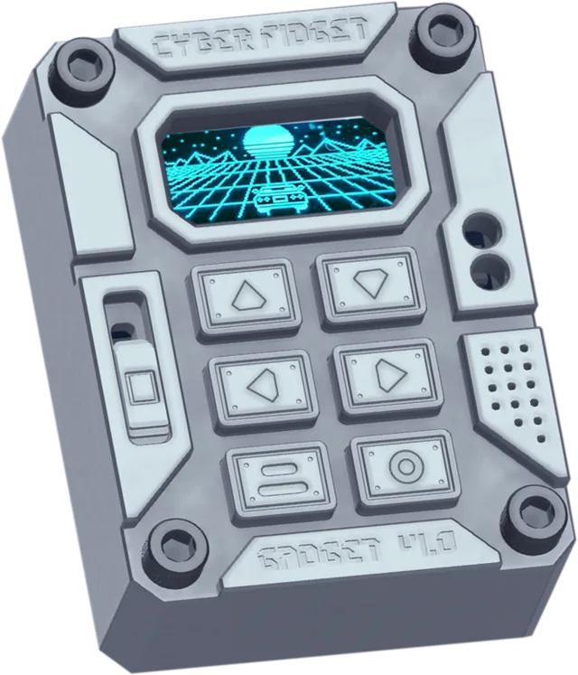
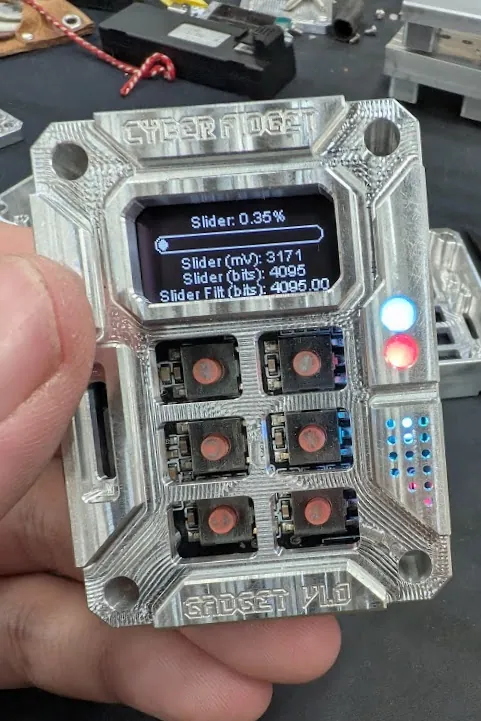
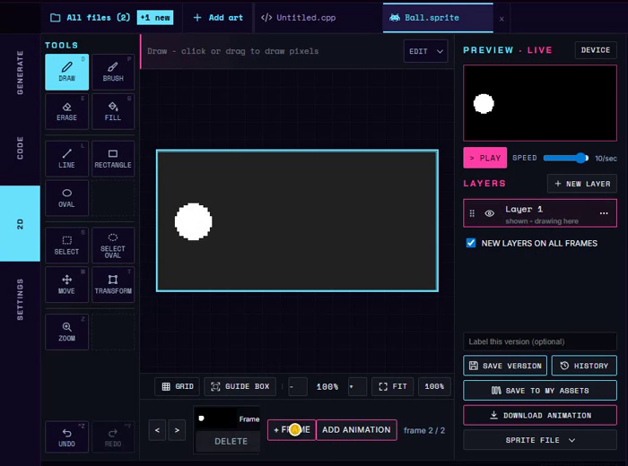

# Product Overview

{ width="300" height="350" }

<strong>A machined-aluminum, pocket-sized gadget built for play, tinkering, and experimentation.</strong> Designed and assembled in Michigan.

After this page you will know what Cyber Fidget is, what's inside it, what comes in the kit, and where to go next.

[Assembly guide](../getting-started/assembly/guide.md){ .md-button .md-button--primary }
[Build your first app](../getting-started/first-app.md){ .md-button }

- Pocket-sized
- Screen, buttons and a slider
- Lights and sound
- Wi-Fi + Bluetooth
- Screws together, no soldering
- Open source

## What is Cyber Fidget?

Cyber Fidget is two things at once:

-   { loading=lazy width="350" height="540" }

    **1. An electronic fidget toy**

    ---

    Beyond a spinner or clicker: something with a screen, buttons, LEDs, and sound that's fun to hold and play with.

-   { loading=lazy width="481" height="721" }

    **2. An approachable dev board**

    ---

    A development board with everything already included: display, buttons, slider, speaker, mic, accelerometer, LEDs, SD card, Wi-Fi, and Bluetooth.

It's meant to feel good in your hands, be easy to use without knowing how it works, and be fully hackable when you're ready to dig in.

---

## What's inside

{ loading=lazy width="300" height="397" }

| | |
|---|---|
| **Size** | 2.2 x 1.6 x 0.8 in (55.3 x 41.3 x 19.6 mm) |
| **Weight** | ~68 g (varies by backplate) |
| **MCU** | ESP32-PICO-MINI-02 (Wi-Fi + Bluetooth) |
| **Display** | 0.96" 128x64 monochrome OLED |
| **Controls** | 6 buttons + analog slider |
| **Audio** | Speaker + MEMS microphone |
| **LEDs** | 4x RGBW (3 front, 1 back) |
| **Storage** | microSD card |
| **Power** | 400 mAh LiPo, USB-C charging |
| **Body** | Precision-machined aluminum |

The MCU (microcontroller) is the small computer that runs your apps. For the full component list with part numbers, see [Hardware Specs](../hardware/specs.md).

---

## What you can do with it

-   { .cf-contain loading=lazy width="300" height="400" }

    **Play**

    ---

    The firmware ships with 29+ built-in apps: games, screensavers, tools, and examples.

    [Built-in apps](../software/apps.md)

-   { loading=lazy width="700" height="520" }

    **Draw and animate**

    ---

    Draw sprites (small pictures for characters and objects) and animate them in the studio on cyberfidget.com.

    [Studio overview](../studio/overview.md)

-   { .cf-contain loading=lazy width="418" height="620" }

    **Make your own apps**

    ---

    Write apps in your browser and watch them run in the emulator (an on-screen copy of the device), then install them on your Cyber Fidget.

    [Build your first app](../getting-started/first-app.md)

-   { .cf-contain loading=lazy width="300" height="400" }

    **Build 3D models**

    ---

    Build wireframe models from points and lines in the studio, then show them in your apps. The 3D tab appears when it is enabled for your account.

    [3D models](../studio/3d-models.md)

It also records [voice notes](../firmware/voice-recorder.md) to the memory card, pairs with your phone through the [Phone Companion](../firmware/companion.md), and serves a [Web Portal](../firmware/web-portal.md) you can open in a browser to manage music files.

---

## What's in the kit

{ loading=lazy width="1100" height="1100" }

Cyber Fidget primarily ships as a self-assembly kit -- no soldering, just screws. The kit includes:

- Machined aluminum chassis (front and back)
- Assembled PCB with all components pre-soldered
- Buttons, slider, and hardware
- Screws and fasteners
- Interchangeable screen color filters

Assembly takes about 15 minutes. See the [Assembly Guide](../getting-started/assembly/guide.md) for step-by-step instructions with photos.

---

## Made for tinkerers

{ loading=lazy width="1000" height="1000" }

Every screw and part is accessible. The enclosure is built to be opened, explored, and modified:

- **Re-color it** -- swap screen colors (blue, red, teal, and more)
- **Redesign it** -- 3D print your own backplate or case modifications
- **Hack it** -- make your own apps in the studio, or change the firmware source code itself
- **Learn from it** -- ideal for learning how to code, embedded systems, sensors, and human-machine interfaces

More in [Accessories](accessories.md).

---

## Who it's for

-   **Players and fidgeters**

    ---

    You don't need to know how it works to enjoy it. Turn it on and pick a game or screensaver from the menu.

    [Built-in apps](../software/apps.md)

-   **New coders and game makers**

    ---

    Write apps in your browser with nothing to install, and see them run straight away.

    [Make a game, step by step](../getting-started/make-a-game.md)

-   **Teachers and families**

    ---

    The browser path needs no installs and no device. A teacher guide is in development.

    [Explore what it can do](../getting-started/explore.md)

-   **Makers and firmware developers**

    ---

    The firmware and these docs are open source, and the hardware is documented down to the pins.

    [Open source](open-source.md) | [Pinout](../hardware/pinout.md)

---

## Software

The firmware ships with 29+ built-in apps (games, screensavers, tools, examples). See [Apps](../software/apps.md) for the catalog.

Make your own apps in the [studio](https://cyberfidget.com/create/) in your browser. [Build your first app](../getting-started/first-app.md) takes you from a blank template to an app running in the emulator and on your Cyber Fidget. [Make a game, step by step](../getting-started/make-a-game.md) builds a paddle game with lights, sound and a score.

### Advanced: firmware development

Studio apps do not need this route. To change the firmware or add built-in apps, clone the [firmware repo](https://github.com/cyberfidget/cyberfidget-firmware) and use VS Code with PlatformIO (via pioarduino), the tools that build and install the firmware. See [Firmware development](../firmware/index.md) for setup. The hardware is designed to support CircuitPython, but that support is untested.

---

## See also

- [Hardware Specs](../hardware/specs.md) -- Full specifications with part numbers
- [Pinout](../hardware/pinout.md) -- GPIO assignments
- [Accessories](accessories.md) -- Color filters, backplates, and 3D printing
- [Assembly Guide](../getting-started/assembly/guide.md) -- Build your device
- [First Flash](../getting-started/first-flash-arduino.md) -- Flash firmware for the first time
- [Open Source](open-source.md) -- Repos, licenses, and how to contribute
