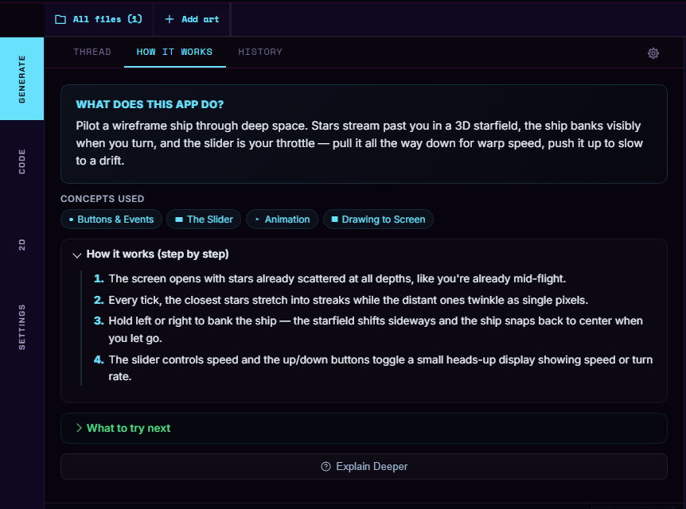

<!-- Cyber Fidget documentation - CC BY-SA 4.0 -->

# Code generator

After this page you can decide whether the studio's code generator fits the way you like to work. If it does, you can use it to start an app from a description, change an app you already have, or get an explanation of how some code works.

!!! note "It's optional"
    You don't need the code generator for anything. Writing code on the **CODE** tab, drawing art, building, the emulator and installing on your Cyber Fidget all work without it, and nothing else in these docs depends on it. If you'd rather not use it, skip this page.

---

## What it is

The studio's **Generate** tab holds the code generator. You describe what you want in plain words. The studio sends your description, and the code it needs, to a model: a large program that writes text and code from a description. The reply lands in your project as ordinary `.h` and `.cpp` files, the same files you would write by hand.

It can:

- **make an app** from a description;
- **change an app** you already have, whether it was generated, written by hand, or loaded from a demo;
- **explain code** step by step, in the **How it works** view;
- **try to fix a build** that failed on code it wrote.

It runs on a free allowance, on your own account with a model provider, or on credits. Credits are rolling out. [Free use, credits and privacy](credits.md) explains the choices and links to the privacy rules.

See the [Terms of Use](https://cyberfidget.com/terms/) for the rules for using the code generator and the [Privacy policy](https://cyberfidget.com/privacy/) for how requests are handled.

---

## Make an app from a description

1. Go to [cyberfidget.com/create/](https://cyberfidget.com/create/) and press **+ Create an app**. The studio opens on the **Generate** tab and asks **What do you want to make?**
2. Type a name in **What do you want to call your app?** The generator waits for a name, because the name you choose becomes the name your code uses. See [Naming your app](ota-builder.md#naming-your-app).
3. Describe your app in the **Describe your app...** box. Or press **Make your first app**: it puts an example description (a screensaver with bouncing shapes and LED colors) in the box for you to read and change.
4. Press **GENERATE** (on a phone, **Go**).
5. Wait for the reply. It appears in the **Thread** view, and the code goes into your project's files, where you can read and edit it on the **CODE** tab.
6. Press **REBUILD** in the emulator panel to build the app and try it. To build after every reply without pressing it, turn on **Rebuild automatically after Generate applies changes** below the emulator.

The line under the box shows how the generator runs for you. The studio shows how many free generations you have and when they reset. **Generator settings** next to it opens the choices described in [Free use, credits and privacy](credits.md).

**Tips for a description:**

- Say what the player does and what they see: "Tilt to roll a ball around a maze; the LEDs turn green when you reach the exit."
- Name the controls you want: buttons, the slider, tilt, sound, LEDs.

---

## Change an app

Type what to change in the same box and press **GENERATE**. The generator works from the code in your project as it is, including any lines you edited yourself.

- **Your own code:** start with **Code from Blank Template** (or any project), write as much as you like, then ask for a change in the **Generate** tab.
- **A demo app:** **Modify a Demo App** loads one of 16 demos, such as Spaceship, Dino Run or Breakout. The thread then says "Describe a change below and the generator picks it up from there."

The thread is the whole back-and-forth for this project. It is saved with the project, so it is still there after a reload.

---

## Understand code: How it works

The **HOW IT WORKS** view explains the app in your project: what it does, which ideas it uses (buttons, the slider, drawing...), how it works step by step, and what to try next.

- **Demo apps** come with their explanation, so it shows straight away.
- **Your own code**, written by hand or generated: press **Explain this code**. The studio sends the code to the code generator and shows the guide it writes.
- **Explain Deeper** asks for a more detailed explanation.

{ width="640" }

At the moment, explanations don't use credits or count toward your free generations.

---

## Go back to an earlier version

The **HISTORY** view lists the versions of your app:

- every reply that changed the code;
- a successful build of code you edited by hand, when it differs from the last version;
- any version you save yourself: type an optional name in **Label this version (optional)** and press **Save version**.

Each version has **See changes** (what changed, compared with **the version before it** or **the current code**, set by **Compare each version to**) and **Load this version**. Loading an old version keeps the newer ones in the list, so you can go forward again.

---

## Start over

**Start Fresh**, below the description box, empties this project: the code, the thread, the description box and the **HISTORY** list. The studio asks first ("Discard ... and start fresh?"). If you might want any of the code later, copy it or save the project elsewhere before you press it; see [Keeping and sharing your work](import-export.md).

---

## When a build fails

If the app doesn't compile and the code came straight from the generator (you haven't edited it since), the studio sends the compiler's error message back to the generator once and builds the corrected code. It does this at most once per reply.

- On the free allowance, this fix doesn't count toward your free generations.
- With credits, it costs no credits.
- With your own key, it is one more request on your account, so the studio asks first: **Always**, **Just this once** or **Never**. You can change the answer later in **Generator settings** under **Auto-fix failed builds**.

If you have edited the code since the last reply, the studio leaves your code alone.

When a request itself fails, the studio keeps your description and offers **Retry** and **Copy prompt**. See [When generating does not work](ota-builder.md#when-generating-does-not-work).

---

## Ways to use it alongside your own work

You decide how much of an app the generator writes: none of it, one piece, or most of it. Some ways to use it as one tool among others:

- **Frame it, then make it yours.** Ask for the skeleton of a game (a title screen, a score, the controls), then draw every sprite yourself in the 2D tab and write the parts that make it yours.
- **The other way round.** Draw the art and write the rules yourself, and ask the generator for one fiddly piece you don't want to write, such as a menu or a high-score table.
- **Try a mechanic quickly.** Before you spend an evening on an idea, ask for a rough version and play it in the emulator to see whether it's fun. Then build the real one however you like.
- **Find a bug.** Describe what you expected and what happened instead: "the ball goes through the paddle when it moves fast - why?"
- **Understand an algorithm.** Write or paste the code you're stuck on and use **Explain this code**, or ask why it behaves the way it does.
- **Read what it wrote.** After a reply, find the line that sets an LED color, or the loop that moves the player, and change it by hand. Reading generated code is good practice for reading anyone's code.

---

## Limits to keep in mind

- **It makes mistakes.** Generated code can fail to compile, do something other than what you asked, or work in an odd way. Try it in the emulator and read it before you rely on it.
- **You are the author.** You choose what to keep, and you're responsible for what you share or install, generated code included.
- **Generated code is ordinary code.** It sits in the same files, follows the same rules and goes through the same compiler and emulator as code you type. You can change any line of it.
- **It only knows what you tell it.** The more specific your description, the closer the result.
- **Check your usage.** The studio shows your free allowance or credit balance. With your own key, check usage with your provider. See [Free use, credits and privacy](credits.md).

---

## See also

- [Free use, credits and privacy](credits.md) - what is free, what costs credits, using your own key, and where to read the privacy rules
- [App Builder](ota-builder.md) - the studio's build, restart and send actions, and choosing a model
- [Build your first app](../getting-started/first-app.md) - write an app by hand, no generator needed
