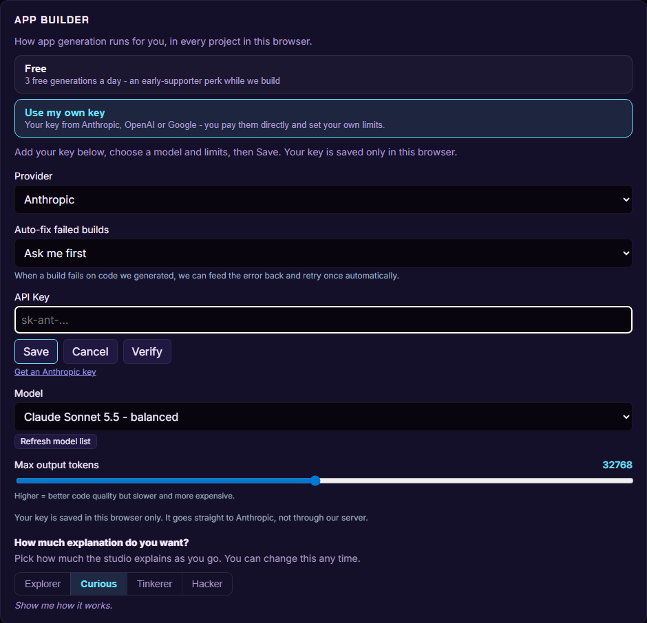

<!-- Cyber Fidget documentation - CC BY-SA 4.0 -->

# Free use, credits and privacy

After this page you know the ways the studio's [code generator](code-generator.md) can run, where to check costs and limits, and where to read the privacy rules.

[Open My account](https://cyberfidget.com/my-fidget/account/){ .md-button }

Nothing on this page applies if you don't use the **Generate** tab. Writing code, drawing art, building and the emulator don't use the code generator.

---

## Three ways to run the generator

**My account** has an **App Builder** card: "How app generation runs for you, in every project in this browser." You can use this card without signing in; signing in adds your profile and credits.

In the studio, **Generator settings** under **Describe your app...** and the small settings icons by the generator open **My account** in a new tab at this card. Your project stays open in the studio tab. The studio's **Settings** tab holds settings for the current app.

--8<-- "includes/generator-ways.md"

---

## Free { #free-built-in }

The free allowance lets you try the code generator without setting anything up. Choose **Free** in **My account**'s **App Builder** card. The card shows your current allowance; the line under the studio's description box also shows your usage.

If you reach the allowance or the free service is busy, follow the studio's message or [use your own key](#use-your-own-key).

---

## Use your own key

An API key (Application Programming Interface key) is a secret code from a model provider's developer website. It lets a program, here the studio, use your account with that provider. The provider charges your account for what you use, by its own prices, and sets its own limits.

1. Get a key from one of the providers in [Supported models](supported-models.md). The **App Builder** card links to each provider's key page.
2. Open [My account](https://cyberfidget.com/my-fidget/account/) directly, or use the studio's **Generator settings** link. In **App Builder**, choose **Use my own key**.
3. Pick the **Provider** and paste the key into **API Key**. **Verify** checks that the provider accepts it.
4. Pick a **Model**. **Refresh model list** asks the provider which models your key can use. See [Choosing a model](ota-builder.md#choosing-a-model).
5. Press **Save**. **Save** keeps the key, the model, **Max output tokens** and **Auto-fix failed builds** together; **Cancel** puts back what was saved.

Your key is saved only in this browser.

{ width="640" }

The line under the description box then shows the model name followed by **your key**.

In the same card, **Auto-fix failed builds** offers **Ask me first**, **Always (uses your key for one extra call)** and **Never**. **How much explanation do you want?** sets the level of explanation.

The **Max output tokens** slider limits how long one reply can be. A token is a small piece of text, often part of a word; providers count and charge by tokens. A higher limit lets the model write more code in one reply, but each reply can take longer and cost more.

Check your provider's prices, limits and terms before using your key. For privacy details, read the [Privacy policy](https://cyberfidget.com/privacy/) and your provider's policy.

---

## Use my credits

Credits are rolling out to signed-in accounts. If your account has them, the **App Builder** card on **My account** shows a third choice, **Use my credits**, and **My account** also shows a **Credits** card with your balance, the typical cost for each model and your history.

- **Choosing a model:** pick one in **Model for credit generations** in the **App Builder** card, or press the model name in the line under the studio's description box. That line reads, for example, the model name and how many credits you have.
- **What a generation costs:** each model shows "about N credits for a typical generation". The real charge is worked out from what that generation used: what Cyber Fidget is billed for it, plus a small markup to cover payment processing fees, maintenance and updates, then rounded up to the nearest whole credit. Each reply in the thread shows the model and the credits it used. Check the prices shown before generating.
- **What costs nothing:** a generation that fails on Cyber Fidget's side costs 0 credits and is returned automatically. The automatic fix of a failed build costs 0 credits. Free-allowance and own-key generations don't use credits.
- **Expiry:** the **Credits** card shows which of your credits expire, their expiry dates, and which are spent first. Promo codes go in **Have a promo code?** on the same card.
- **More credits:** enter a reason in **Request more - reason** on the **Credits** card, then choose **Request more**. A person at Cyber Fidget reviews each request.
- **Buying:** buying credits is rolling out. If your account offers it, **Buy credits** shows each pack and its price, and the refund terms, before you pay.

---

## Check costs and choices

**My account**'s **App Builder** card shows your free allowance, and the **Credits** card on the same page shows your balance and the typical cost of each model. With your own key, the provider decides which models your key can use and what they cost.

!!! note "Tell us what you think"
    We're still learning what works best for the code generator, the free allowance and credits. If you have an idea, or something didn't work the way you expected, tell us through the [contact page](https://cyberfidget.com/contact/).

---

## Privacy

Read the [Privacy policy](https://cyberfidget.com/privacy/) for how requests and project information are handled, and the [Terms of Use](https://cyberfidget.com/terms/) for the rules for using the generator. If you use your own key, read your provider's terms and privacy policy too.

!!! warning "Keep private information out of your requests"
    Leave passwords, keys and personal details out of your descriptions and project code when using the code generator.

---

## See also

- [Code generator](code-generator.md) - what it does and how to use it alongside your own work
- [App Builder](ota-builder.md) - choosing a model, and what to do when generating doesn't work
