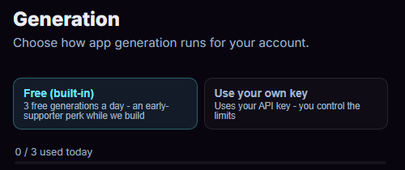

<!-- This page is a draft for review. Every limit and privacy statement here was checked against the studio and the website's Privacy policy; please confirm the "What may change" wording before it merges. -->

# Free use, credits and privacy

After this page you know the ways the studio's [code generator](code-generator.md) can run, what each one costs, and what is sent where when you use it.

Nothing on this page applies if you don't use the **Generate** tab. Writing code, drawing art, building and the emulator never use the code generator.

---

## Three ways to run the generator

**Generator settings**, the small link under the **Describe your app...** box, opens **SETTINGS > ACCOUNT > Generation**, where you choose how generation runs.

{ width="500" }

| Choice | Who pays | Limits | Sign-in |
|---|---|---|---|
| **Free (built-in)** | Cyber Fidget | A few generations a day, shared by everyone on your network | Not needed |
| **Use your own key** | You, through your own account with a model provider | Your provider's limits and prices | Not needed |
| **Use my credits** | Credits on your account | Your credit balance | Needed; shown only on accounts that have credits |

---

## Free (built-in)

The free allowance is there so you can try the code generator without setting anything up.

- **How much:** the settings show the number, for example "3 free generations a day - an early-supporter perk while we build". The line under the description box counts them: **(free - 0/3 used)**.
- **Per network, per day:** the count belongs to your internet connection, not to you. At a school, a library or a game jam, everyone on the same WiFi shares one allowance. If yours runs out, [use your own key](#use-your-own-key) or come back the next day.
- **Only successes count:** a request that fails doesn't use up a generation, and neither does the [automatic fix of a failed build](code-generator.md#when-a-build-fails). After many failed requests from one network in a day, the studio asks you to try again later.
- **Explanations are separate:** **Explain this code** and **Explain Deeper** have their own, larger daily allowance.
- **Busy days:** the free allowance also has an overall daily budget for everyone. When it's reached, the studio says "Free generations are at capacity right now."
- **Which model:** the free allowance uses a model from Anthropic that Cyber Fidget picks. Each reply in the thread ends with the name of the model that wrote it.

---

## Use your own key

An API key (Application Programming Interface key) is a secret code from a model provider's developer website. It lets a program, here the studio, use your account with that provider. The provider charges your account for what you use, by its own prices, and sets its own limits.

1. Get a key from one of the providers the studio supports: **Anthropic**, **OpenAI** or **Google Gemini**. The settings link to each provider's key page.
2. Open **Generator settings** and choose **Use your own key**.
3. Pick the **Provider**, paste the key into **API Key** and press **Save**. **Verify** checks that the provider accepts it.
4. Pick a **Model**. **Refresh model list** asks the provider which models your key can use. See [Choosing a model](ota-builder.md#choosing-a-model).

The line under the description box then reads **Using your key** and names the provider or model.

**Max output tokens** limits how long one reply can be. A token is a small piece of text, often part of a word; providers count and charge by tokens. A higher limit lets the model write more code in one reply, but each reply can take longer and cost more.

**Google Gemini (free!)**: Google offers API keys with a free allowance. Google's terms for free keys differ from its paid ones, including what it may do with what you send. Read them before you choose.

**Where your key goes:**

- The key is stored in this browser only.
- With **Anthropic** or **Google Gemini**, your browser talks to the provider directly. The key is never sent to Cyber Fidget's server.
- With **OpenAI**, requests pass through Cyber Fidget's server, because OpenAI doesn't accept them straight from a browser. The key is passed on and not stored.

---

## Use my credits

Credits are available on some signed-in accounts. If your account has them, **Generator settings** shows a third choice, **Use my credits**, and **SETTINGS > ACCOUNT** shows a **Credits** card with your balance, the typical cost for each model and your history.

- **Choosing a model:** pick one in **Model for credit generations**, or press the model name in the line under the description box. That line reads, for example, the model name and how many credits you have.
- **What a generation costs:** each model shows "about N credits for a typical generation". The real charge is worked out from what that generation used: what Cyber Fidget is billed for it, plus a small markup, rounded up. Each reply in the thread shows the model and the credits it used.
- **What costs nothing:** a generation that fails on Cyber Fidget's side costs 0 credits and is returned automatically. The automatic fix of a failed build costs 0 credits. Free-allowance and own-key generations never use credits.
- **Expiry:** included credits never expire. Credits from a promo code (**Have a promo code?**) expire on the date the card shows, and are spent first.
- **More credits:** the card has **Request more**, with an optional message. A person at Cyber Fidget reviews each request.
- **Buying:** buying credits isn't available on every account. Where it is, **Buy credits** shows each pack and its price, and the refund terms, before you pay. Bought credits never expire.

---

## What may change

The code generator is an early part of the studio, and these parts of it may change:

- the size of the free allowance, whether it renews every day or is given once, and which model runs it;
- which models are offered for credits, and how many credits a typical generation takes;
- whether credits, and buying them, are open to more accounts.

The studio always shows the current numbers: the allowance in **Generator settings** and the line under the description box, and credit costs in the **Credits** card. With your own key, the provider decides which models your key can use and what they cost.

---

## What is sent where

When you press **GENERATE** (or **Explain this code**), the studio sends what the model needs to answer:

- your description and the earlier messages of the thread;
- your project's code;
- the names, sizes and animation names of your project's art and models, so the generated code can use them. The pictures themselves are not sent.

| You use | Where it goes | What Cyber Fidget keeps from the request |
|---|---|---|
| Free allowance | Through Cyber Fidget's server to a code-generation service that Cyber Fidget pays for | Usage counts, not your description or code |
| Credits | Through Cyber Fidget's server to a code-generation service that Cyber Fidget pays for | Your credit history; see the Privacy policy for the rest |
| Your own key: Anthropic or Google | From your browser straight to that provider | Nothing |
| Your own key: OpenAI | Through Cyber Fidget's server to OpenAI | Nothing (the key is passed on, not stored) |

With your own key, the studio first fetches its instructions for the model from Cyber Fidget's server. That step sends your art names, and for an explanation your code, so the instructions can mention them; they are not kept.

With your own key, the provider's own terms and privacy rules apply to what you send.

The thread and the code are part of your project. They stay in your browser, or, when you're signed in, are saved to your account with the project.

To count the free allowance per network, the website keeps a scrambled code made from your connection's address, not the address itself.

For the full details, read the [Privacy policy](https://cyberfidget.com/privacy/) and the [Terms of Use](https://cyberfidget.com/terms/).

!!! warning "Keep private information out of your description and code"
    Whatever you type into the description box, and any code in your project, is sent to the model provider. Leave out passwords, keys and personal details.

---

## See also

- [Code generator](code-generator.md) - what it does and how to use it alongside your own work
- [App Builder](ota-builder.md) - choosing a model, and what to do when generating doesn't work
