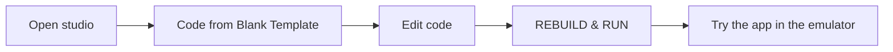
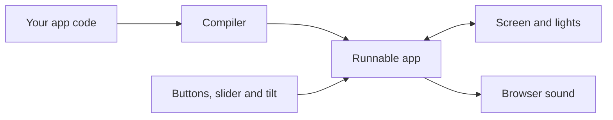
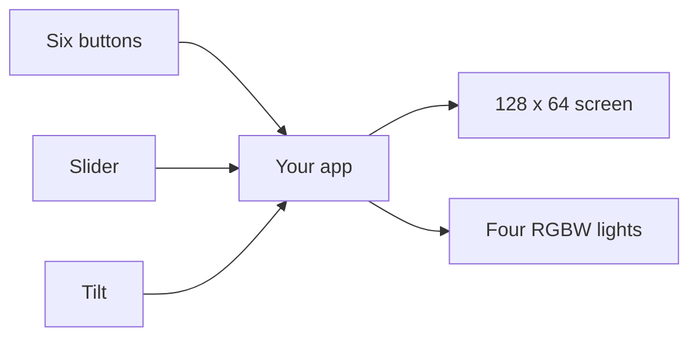
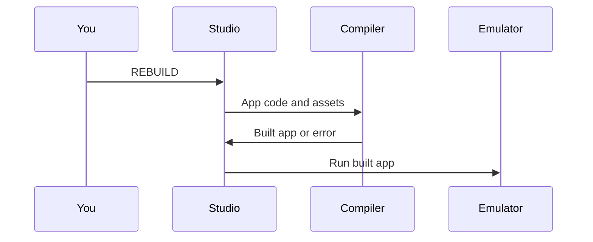

# Browser Emulator

After this page you can build an app, try its controls and investigate problems in the emulator.

The Cyber Fidget browser emulator runs your app in the studio, with no hardware required. It shows the screen, buttons, slider and lights, plays sound, and lets you try tilt controls. Test microphone input and physical controls on a real Cyber Fidget too.

!!! tip "Who is this for?"
    - **App developers**: Try code and controls before installing on a device.
    - **Newcomers**: Try apps without owning a Cyber Fidget.
    - **Studio users**: Test generated code and make changes.

---

## Where to find it

Open the [studio](https://cyberfidget.com/create/). The emulator panel is beside your code on a computer and on the **TEST** tab on a phone. Use **REBUILD & RUN** in the welcome panel to compile and run the app. The persistent build button is **REBUILD**.

!!! example "Screenshot"
    

---

## Quick Start

### 1. Open the studio

Go to [cyberfidget.com/create/](https://cyberfidget.com/create/) and press **+ Create an app**. GitHub sign-in is not required for the browser build in this guide.

### 2. Write or Generate an App

Choose **Code from Blank Template** to write code, **Modify a Demo App** to explore an example, or generate an app from a description. The [first-app guide](../getting-started/first-app.md) starts with the blank template.

### 3. Compile

Press **REBUILD & RUN** in the welcome panel, or **REBUILD** in the emulator panel. Compilation turns your C++ code into a runnable app. When building on your computer is available, the first build downloads about 23 MB of build tools; allow it to finish. Later builds on the computer can take a few seconds. If the computer cannot build, or building there is unavailable, the studio uses its build server; allow more time.

!!! warning "Keep private information out of code"
    Builds on your computer keep your code on your computer. If the studio uses the build server instead, that build is public. Keep personal information and secrets out of your code either way.

Builds sent to the build server have a daily limit. Builds done on your own computer do not count toward it.

### 4. Run

The built app starts in the emulator. Click its buttons, drag the slider, or use the shortcuts below. **<< RESTART** starts the built copy again. After editing code, use **REBUILD** to try your changes.

---

## How the emulator fits together

The same app functions drive the browser preview and the installed app. The hardware abstraction layer (HAL) provides screen, input and sound functions without your app needing to control the electronics directly. The [app function reference](../reference/functions.md) lists the supported functions and differences between the device and emulator.

---

## Emulator Controls

The emulator follows the physical Cyber Fidget layout:

| Physical Control | Emulator Equivalent | Keyboard Shortcut |
|---|---|---|
| Top Left button | Click Top Left button | `Q` |
| Top Right button | Click Top Right button | `E` |
| Middle Left button | Click Middle Left button | `A` |
| Middle Right button | Click Middle Right button | `D` |
| Bottom Left button | Click Bottom Left button | `Z` |
| Bottom Right button | Click Bottom Right button | `C` |
| Slider | Drag the slider on the left | - |
| Screen (128 x 64) | Screen inside the case | - |
| Three front lights and one back light | Lights on and behind the case | - |

The case hides about 8 pixels at each screen corner. Keep important text and pictures away from those corners, as on the device.

### Panel controls and hints

- **<< RESTART** starts the built app again, including after its bottom-left button exits.
- **Volume and mute** adjust browser playback. They do not change the device's volume. Studio apps cannot set device volume with `setVolume()`.
- **Button hints** show the keyboard shortcuts. Click outside the code editor before using them.
- **Tilt** uses the mouse on desktop or device orientation where the browser supports it.

Use **Modify a Demo App** in the start panel to load a built-in example you can change and rebuild.

### Console

The **Console** panel shows build and run messages. The app headers do not provide a `Serial` object, so studio examples cannot call `Serial.println()`. Show a changing value on the screen instead; [The Slider](../concepts/slider.md#code-example-slider-controlled-brightness) demonstrates this with `snprintf()` and a character buffer.

---

## How Compilation Works

When you press **REBUILD**, the studio builds your code and starts the emulator:

1. The studio collects the app's `.h` and `.cpp` files and its assets.
2. Compilation runs on your computer or the build server, depending on the build settings and availability.
3. Compiler errors appear in the studio so you can fix your code.
4. A successful build starts in the emulator.

The browser build downloads compiler support files and can reuse them for later builds. It does not need your own fork of the firmware repository. The [contributor guide](../contribute/emulator-dev.md) covers building the emulator from firmware source.

### Build Cache

The browser stores built apps and supporting files so it can reuse them. **<< RESTART** runs the built copy; **REBUILD** compiles your current edits. Browser storage belongs to that browser and site. Keep your project saved, and export a project file when you need a separate backup.

---

## What Works in the Emulator

| Feature | What to expect |
|---|---|
| Screen | 128 x 64 pixels, including the case's corner cuts |
| Six buttons | Click the buttons or use `Q/E/A/D/Z/C` |
| Slider | Same app variables: 0-100%, 0-255, or 0-4095 |
| Four RGBW lights | Red, green, blue and white, each 0-255; appearance depends on your screen |
| Tones, notes and sequences | Browser playback; volume and mute controls affect the preview |
| Accelerometer | Simulated tilt from mouse or supported phone orientation |
| Microphone | No input; test sound-reactive behavior on a device |
| Serial logging | `Serial.println()` is unavailable to studio apps |
| Battery, WiFi and deep sleep | Hardware features outside the studio app interface |

Studio apps run as the same device module (the built app) in the browser emulator and on the device. In both places, `drawStringMaxWidth()` draws an unwrapped line, `isSequencePlaying()` always returns `false`, and `setVolume()` has no effect. Use short lines, time your own app logic with `millis()`, and use the emulator controls for browser volume.

---

## Tips

- **Use keyboard shortcuts** for quick button tests. Click outside the editor first.
- **Test tilt on a device too.** Simulated movement helps with logic; physical movement feels different.
- **Show values on the screen** when checking inputs or app state.
- **Check lights on hardware.** Browser glow and screen brightness cannot reproduce physical LED brightness exactly.
- **Keep important pixels out of corners.** The case covers about 8 pixels at each one.
- **Use `millis()` for timing.** `delay()` does nothing in studio apps on the device or in the browser emulator.
- **Test cleanup.** Exit with the bottom-left button, then restart. Sound and lights should stop on exit; register buttons in `begin()` and unregister them in `end()`.

---

## Troubleshooting

### Build fails

For browser errors, press F12 on a computer and open the browser developer tools' Console tab. This is separate from the studio's **Console** panel. It can show loading and playback errors, but studio apps cannot write `Serial.println()` messages there.

Read the first compiler error. It names the file and line to fix. Use only functions in the [app function reference](../reference/functions.md). A firmware example may rely on hardware libraries that studio apps cannot use.

### App compiles but doesn't run / blank screen

Check that `update()` draws something and finishes. A loop that never returns prevents the app from advancing. Press **<< RESTART** to retry, or fix the code and press **REBUILD**. The [first-app guide](../getting-started/first-app.md) gives a small working starting point.

### App compiles but doesn't behave right

Show input values on the screen and check your button indices. The update target is about 50 times per second, but slow code or a busy browser can delay frames. Test device-only features, especially the microphone, on your Cyber Fidget.

### LEDs appear dim or the wrong color

Use the order red, green, blue, white, with values from 0 to 255. Pixel 0 is the back; 1, 2 and 3 are the front top, middle and bottom. Browser glow is an approximation. See [LEDs & Color](../concepts/leds.md).

### "CORS" or "file://" errors when loading WASM

Cross-Origin Resource Sharing (CORS) is a browser rule about loading resources. Open the studio on its website. Running downloaded emulator files directly from a `file://` address does not supply the web server they need. For local development, follow the [Emulator Dev Guide](../contribute/emulator-dev.md).

### Buttons or slider don't respond

Click outside the code editor before using `Q/E/A/D/Z/C`. On a phone, use the on-screen buttons. If you exited the app with bottom-left, press **<< RESTART**.

### Console is empty

Studio apps do not provide `Serial.println()`. The console can show build and run messages, but display your own diagnostic values on the app's screen.

### Different browser or device: cache not there

Browser storage is separate for each browser and site. Export your project and import it in the other browser, then use **REBUILD** there.

### I want to run completely offline

The studio needs an internet connection to load its files and any compiler support files it has not cached. For a local firmware development setup, see the [Emulator Dev Guide](../contribute/emulator-dev.md).
