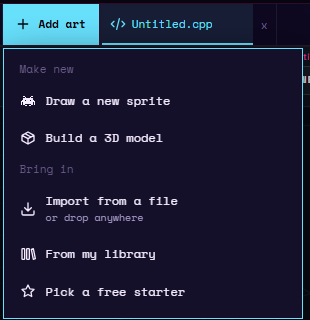
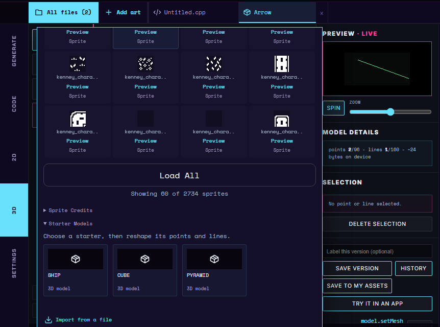
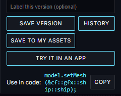

# 3D Models

The 3D tab is Studio's tool for building wireframe models -- simple 3D shapes your app can spin and display on the Cyber Fidget's OLED screen, drawn as glowing line art like a classic vector arcade game.

!!! note "Early access"
    The 3D tab is available to selected accounts for testing. It only appears in the tab strip for accounts we've turned it on for, and there's currently no self-service way to request it -- unlike the [Beta Access](../software/beta-access.md) features (firmware editing, compiling, and installing), which you can request from your account menu. If you don't see a **3D** button next to **Code** and **2D**, it isn't enabled for your account yet.

---

## What is a wireframe model?

A wireframe model is a 3D shape made of **points** (also called nodes, positioned in space) connected by **lines** (also called struts, straight lines between two points). There are no solid surfaces -- only the points and the lines between them. That's what lets the shape spin cleanly on a monochrome display: the device draws the lines as it would any other line, from whatever angle the model is currently facing.

---

## Opening the 3D tab

Click **3D** in Studio's tab strip (alongside **Generate**, **Code**, and **2D**) to open the model workspace. On a desktop or laptop, models use the same two buttons above the workspace as sprites do: **All files** and **Add art**. See [Your Sprite Library](your-sprite-library.md) for how they work. For models:

- **Add art > Build a 3D model** opens a **New model** dialog that asks for a **Model name** (it suggests one such as `Model 1`). **Create** starts a new model: two points joined by one line. **Add art > Import from a file** brings in a `.cfmesh.json`, `.obj` or `.stl` file.
- **All files > In this project** lists every model already in this project, under the heading **3D models**.
- **All files > My library** holds your account's saved models, under the heading **My Assets**. Sign in to use this; it's shared with your sprite library, holding up to 50 assets total between the two.
- **All files > Free starters** has a **Starter Models** section with three ready-made shapes (**SHIP**, **CUBE**, **PYRAMID**) to reshape instead of starting from nothing. Click one to add it to the project. The section is below the starter sprites, so scroll down inside the window to reach it.

<video src="../../assets/media/3d-new-model.webm" poster="../../assets/media/3d-new-model.png" autoplay loop muted playsinline width="560"></video>

*Opening the 3D tab, then Add art > Build a 3D model, naming the model Arrow and choosing Create.*

---

## Editing a model

The model stage in the middle of the workspace is an interactive 3D view. Three tools sit in the tool column to its left:

- **Move** -- drag the model to spin it; drag a point to reshape it; scroll to zoom the view in or out; click a line to select it.
- **Connect** -- click one point, then another, to draw a line between them (or remove one that's already there). Press Esc to cancel a pending connection.
- **Add point** -- click empty space to place a new point; click an existing line to split it, inserting a fresh point at its midpoint. A new point lands on the flat slice through the middle of the model that faces you, so turn the view first to place a point nearer or farther.

The hint under the stage repeats what the current tool does.

<video preload="none" data-src="../../assets/media/3d-add-points-lines.webm" poster="../../assets/media/3d-add-points-lines.png" loop muted playsinline width="560"></video>

*Add point with Mirror on (each point off the middle line gets a twin), then Connect to join the points into an arrow, then Move to turn the view.*

A **Mirror** toggle (it reads **Mirror: on** or **Mirror: off**) keeps the model symmetric left-to-right. With Mirror on, editing a point or line on one side updates its mirrored twin on the other side of the center line automatically -- handy for anything meant to look the same from both sides, like a ship or a face.

<video preload="none" data-src="../../assets/media/3d-move-rotate-view.webm" poster="../../assets/media/3d-move-rotate-view.png" loop muted playsinline width="560"></video>

*The SHIP starter with the Move tool: turning and zooming the view, dragging a point (its twin follows), selecting a line, then Mirror off so a drag moves one point only, and Undo.*

**Undo** and **Redo** buttons step back and forward through your edits (also available as Ctrl+Z, Ctrl+Shift+Z, and Ctrl+Y). Delete or Backspace, or the **Delete selection** button, removes whichever point or line is currently selected.

A model can hold up to 96 points and 160 lines. The **Model details** panel shows your current counts against those limits, along with the model's approximate size in bytes once installed on the device.

---

## The live preview

Next to the editor, the **Preview** panel (marked **live**) renders your model using the same math the device itself uses to draw it, so what you see in Studio is what your Cyber Fidget will show. A **Spin** toggle turns continuous rotation on or off, and a **Zoom** slider adjusts how large the preview appears.

---

## Importing a model file

If you already have a 3D model from another program, you can bring it in instead of rebuilding it by hand. Studio reads two common 3D file types, in addition to its own `.cfmesh.json` files:

- **OBJ** (`.obj`) -- a Wavefront OBJ file, a plain-text format that lists a model's vertices and then the faces or lines that join them.
- **STL** (`.stl`) -- a triangle-list file, the format most 3D printing programs use. Both the binary and the text versions of STL work.

A *vertex* is a corner point of a 3D model; it becomes a node in Studio. A *mesh* is the whole network of vertices and faces. Most 3D programs build faces out of *triangles*, three-cornered flat patches.

!!! note "Arrives with the next website update"
    Importing OBJ and STL files is coming with the next website update. Until then, **Add from file** only opens Studio's own model files.

### How to import

1. Open the **3D** tab and expand **Project Files** in the sidebar.
2. Choose **Add from file** (next to **New model** and **Save to file**).
3. Pick your `.obj` or `.stl` file.

Studio adds the model to the open project and selects it, and the status line reads **Model added from file.** Your other models are left alone. The model is named after the file, without the `.obj` or `.stl` ending.

### What happens to the model

A wireframe model has no solid surfaces, so Studio keeps the outline and throws the rest away:

- **Faces become lines.** Each edge of each face becomes a strut, and the face itself is dropped. OBJ line (`l`) entries come in as struts directly. Colours, textures, and surface-smoothing data are ignored.
- **Hidden diagonals are removed.** Triangle-built models split every flat face into triangles, which would draw a diagonal across each one. Where two triangles lie in the same flat plane, Studio removes the line between them, so a cube made of 12 triangles comes in as the 12 lines of a cube rather than 18. A dot that you placed on purpose along a straight run is kept.
- **Duplicate points are merged.** Points at the same position (STL files store each triangle's corners separately) are joined into one node.
- **The model is centred and scaled to fit.** Studio centres it and resizes it so its longest direction fills the model grid, with every node snapped to a whole-number grid position. The original size is not kept. Nodes that land on the same grid spot after snapping are merged.

### Limits

The device can hold up to 96 nodes and 160 struts per model, and Studio checks the limits after the diagonals are removed and the points merged. If a file is over, Studio refuses it and shows one of these messages:

| Message | What it means |
|---|---|
| **This model has N dots - Cyber Fidget models max out at 96. Try a low-poly version.** | After cleanup the model still has more than 96 nodes. |
| **This model has N lines - Cyber Fidget models max out at 160. Try a low-poly version.** | After cleanup the model still has more than 160 struts. |
| **This file is N MB - Studio can only open model files up to 25 MB. Try a low-poly version.** | The file is larger than 25 MB. Studio refuses it before reading it. |
| **This model has N triangles - too detailed to bring in. Try a low-poly version.** | (STL only) The file has more than 20,000 triangles. A model that fits the device needs only a few hundred, so Studio does not try to process a huge one. |
| **This model has an unreadable part on line N. Try saving it again.** | (OBJ only) A line of the file is malformed or points at a vertex that does not exist. Re-export it from your 3D program. |
| **This file looks damaged. Try saving it again.** | (STL only) The file is truncated or its contents are invalid. |
| **This file is empty. Choose a model file.** | (STL only) The file has no content. |
| **This file is not a model Studio can open.** | (STL only) The file is text but is not an STL file. |
| **This model has no lines to import. Try a model with connected dots.** | The file has points but nothing joining them, so there is nothing to draw. |

### Tips

- **Start low-poly.** Aim for a few dozen vertices. Most 3D programs have a way to reduce detail. In Blender, add a **Decimate** modifier (*decimate* means to cut a mesh down to fewer triangles while keeping its overall shape), or choose a low-poly version of the model when you export.
- **Use simple shapes.** Models with flat faces, such as boxes, ships, and buildings, come out cleanest. Smooth curved models need many triangles to look round, so they usually go over the limit.
- **Combine meshes first.** If your scene has several separate objects, join them into one mesh before exporting, or export just the part you want.
- **If you're over the limit,** simplify in your 3D program and import again, or import a simpler version and add detail by hand with the **Add** and **Connect** tools. You can also edit an imported model like any other.
- **Keep the original.** Importing makes a copy in Studio; your OBJ or STL file is not changed.

---

## Saving and reusing models

Like drawings in the 2D panel, models keep their own version history:

- **Save version** stores a checkpoint, with an optional label.
- **History** opens the list of saved versions, each with a **Restore** option.

To reuse a model in other projects, choose **Save to My Assets** and give it a name. From then on, that model appears in **All files > My library** in any project -- clicking it there copies the model in, leaving the saved original untouched.

**Rename** on a saved model's card changes its name in the library. Its saved
versions are kept, and projects that already copied it are unaffected. See
[Your Sprite Library](your-sprite-library.md) for the full rules, which apply
to models and sprites alike.

---

## Using a model in an app

Once you have a model you like, select **Try it in an app** (in the right-hand column, under **Save to My Assets**):

- If your project has no app code, Studio starts you from a small viewer app named after the model (for example `Arrow Viewer`) that shows the model spinning, switches you to the **Code** tab, and builds it so you can run it. In the emulator, the slider makes the model bigger or smaller.
- If your project already has app code, Studio switches to the **Generate** tab with a request already filled in, asking to add this model to your existing app.

<video preload="none" data-src="../../assets/media/3d-try-in-app.webm" poster="../../assets/media/3d-try-in-app.png" loop muted playsinline width="560"></video>

<video preload="none" data-src="../../assets/media/3d-try-in-app-emulator.webm" poster="../../assets/media/3d-try-in-app-emulator.png" loop muted playsinline width="240"></video>

*Try it in an app in a project with no code: the viewer app opens in the Code tab and builds; then the emulator spins the model and the slider zooms it.*

While a model is open, Studio also shows a one-line **Use in code** reference with a **Copy** button under **Try it in an app**, for pasting into app code you're writing by hand. Scroll the right-hand column down if you don't see it.

For a step-by-step walk from a new model to a running app, and how the model becomes code, see [Draw a wireframe model in the Studio](../concepts/3d-models.md#draw-a-wireframe-model-in-the-studio).

For what to ask the App Builder for when generating an app around a 3D model, see [App Builder: generating apps with 3D models](../software/ota-builder.md#generating-apps-with-3d-models).
