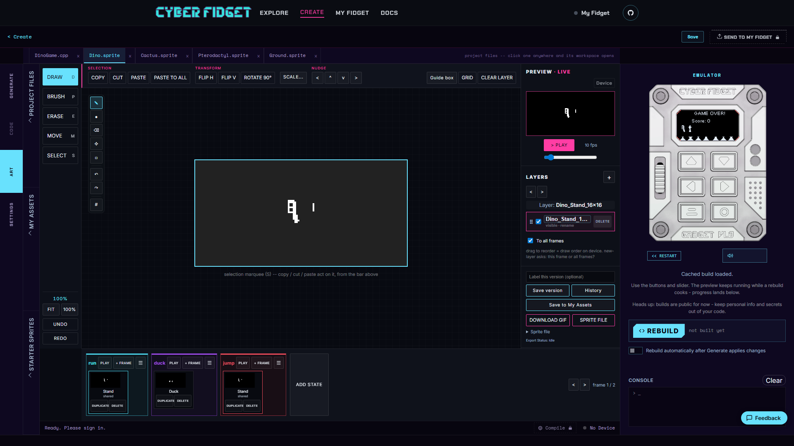

# Animation names

An animation is a named sequence of frames for one action, such as `run`, `duck` or `jump`. The editor calls these groups animations. App code and older file fields may call the same concept an animation state.

## When groups appear

The grouped strip appears for sprites with two or more named animations or the character type. A frame used by more than one animation has a **shared** badge; frames outside all animations appear under **Unassigned**. A simple sprite with one animation keeps the plain frame strip. There, **+ Frame** copies the current frame, and frames have inline **Duplicate** (only when one animation exists) and **Delete** buttons.

On desktop and laptop, the timeline is beneath the canvas. On a phone today it is below Preview, Layers and saving controls. Phone placement will change.

## Work with an animation

Tap or click its **Play** to loop the group, **+ Frame** to copy that animation's last frame into it, or its **☰** menu (accessible name **Actions for ...**) for **Rename** and **Delete animation**. These commands have no dedicated keyboard shortcuts. **Alt+Up** and **Alt+Down** step between frames; tapping a thumbnail is the touch equivalent. See [Animations and frames](animations-and-frames.md) for all timeline commands.

## Match the app's requested names

Code asks for an animation by name. A warning appears when a requested animation has no frames. Add frames or update the requested name in the code. After renaming an animation, check code that uses its previous name.

## Set timing

The default duration is 100 milliseconds (ms) per frame. Zero-duration frames would not be visible and cause build warnings. The single **Speed** control changes playback and saved durations; see [Preview and Speed](preview.md).

For recovering edits, see [Drawing and version history](drawing-and-versions.md).

<!-- Screenshot: shipped animation groups and empty-animation warning. -->
