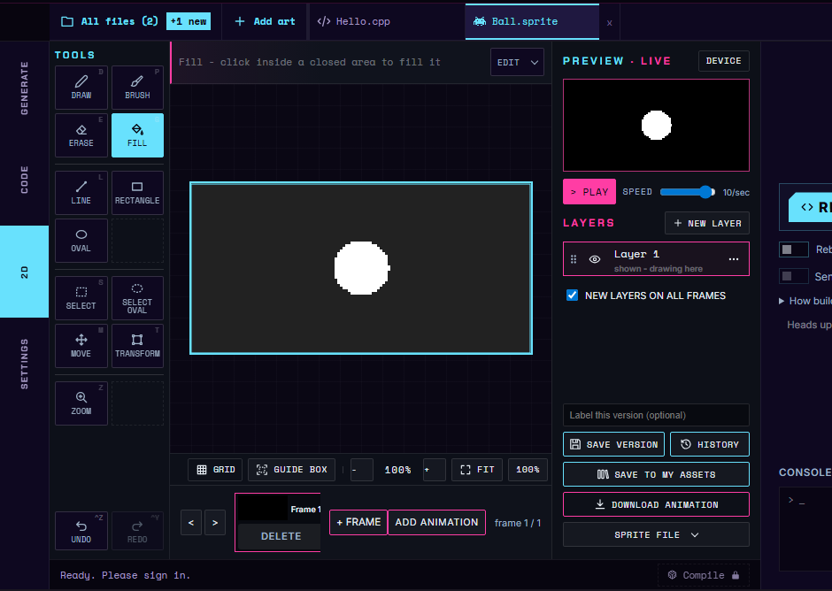
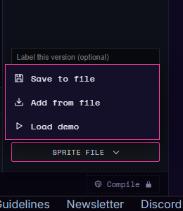

# Files and versions

On a desktop or laptop, the version controls, **Download animation** and the **Sprite file** menu sit in the right-panel footer. On a phone they are in the **Files** sheet: tap the **Files** chip at the top of the 2D tab (it shows the open sprite's name).

All controls below have no dedicated keyboard shortcut. Tap them on a touch screen; tap or type in the version-label field.

| Control | What it does | Desktop / laptop | Phone / touch |
|---|---|---|---|
| Share this sprite | Make a link to a snapshot of this sprite. See [Sharing](sharing.md). | Top of the right-panel footer | Top of the Files sheet. |
| Label this version (optional) | Name a checkpoint so you can find it again. | Right-panel footer | Type in the field in the Files sheet. |
| Save version | Record a checkpoint of the current drawing. | Right-panel footer | Tap Save version in the Files sheet. |
| History | Open saved versions to compare and restore. | Right-panel footer | Tap History in the Files sheet; tap Restore on an entry, or the **Files** back button to return. |
| Save to My Assets | Save a reusable copy in your account library. | Right-panel footer | Tap it in the Files sheet and review the name in the dialog. |
| Download animation | Save an animated Graphics Interchange Format (GIF) image. This is a viewing file, not an editable Studio backup. | Right-panel footer | Tap Download animation in the Files sheet. |
| Save to file | Save an editable `.cfsprite.json` sprite file. | **Sprite file** menu | Tap Save to file in the Files sheet. |
| Add from file | Add a sprite to the open project without replacing existing art. | **Sprite file** menu, or **Add art > Import from a file** in the file strip | Tap Add from file in the Files sheet. |
| Load demo | Load example art to explore the editor. | **Sprite file** menu | Tap Load demo in the Files sheet. |
| All files | List the project's files, including sprites whose editor tabs are closed. See [Your sprite library](your-sprite-library.md). | **All files** button at the left of the file strip | The Files sheet lists the project's sprites. **New sprite** is there too. |
| New sprite | Add a blank sprite to the project. | **Add art > Draw a new sprite**, or **DRAW A SPRITE** when the project has no art | Tap New sprite in the Files sheet. |

**Add from file** is not beside **New sprite** in a file list on a desktop. Use the **Sprite file** menu (**Save to file**, **Add from file**, **Load demo**) when a sprite is open, or **Add art > Import from a file** in the file strip. The **All files** window has an **Import from a file** link at its bottom too.

Export progress is shown while Download animation is working. It is a status readout with no keyboard shortcut or touch action; wait for completion before repeating the download.

To recover earlier work, use History or open a saved file. To keep a whole project, use the [whole-project backup](../software/import-export.md#keep-a-whole-project).

See [Drawing and version history](drawing-and-versions.md) for automatic checkpoints and the 20-version limit, [Your sprite library](your-sprite-library.md) for reusable copies, and [Keeping and sharing your work](../software/import-export.md) for file formats and imports.

