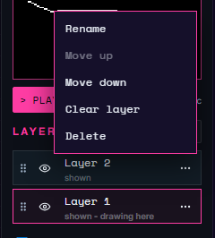

# Layers

A layer is a separate set of pixels in a frame. Layers let you edit part of a picture without disturbing the rest. Their order determines how the drawing is assembled on the device.

[Open the studio](https://cyberfidget.com/create/){ .md-button }

On desktop and laptop, **Layers** is in the right panel below Preview. On a phone, tap the **Layers** chip in the bar below the canvas to open the **Layers** sheet. **New** sits in the sheet's title row.

| Control | What it does | Shortcut | Touch equivalent |
|---|---|---|---|
| New layer | Add a layer to draw on. | None | Tap New in the Layers sheet. |
| New layers on all frames | Add new layers across frames rather than only the current frame. | None | Tap the checkbox beneath the list before adding a layer. |
| Layer row | Select the layer to edit; the highlighted row marks the active layer. | Shift+Up / Shift+Down selects previous / next layer | Tap its row. |
| Drag handle | Reorder layers; this changes drawing order on the device. | None | Drag the handle to another position. |
| Move up / Move down | Move the layer one place up or down the list. **Move up** is unavailable on the top layer and **Move down** on the bottom one. | None | Tap **...**, then **Move up** or **Move down**. |
| Show layer / Hide layer | Include or hide a layer; its status says shown or hidden. | None | Tap the visibility toggle. |
| Name / Rename | Give the layer a recognizable name. | None | Tap the name to edit, or **... > Rename**. |
| Clear layer | Remove the active layer's pixels while keeping the layer. | None | Tap **... > Clear layer**, or **Edit > Clear layer**. |
| Delete | Remove the layer. | None | Tap **... > Delete**. |

Select a layer by choosing its row; the highlighted row is the layer you are drawing on. The reorder hint describes draw order. It is hidden on laptop-width screens (993 to 1500 pixels wide), shows on wider desktops, and is not part of the phone layout.

<video src="../../assets/media/2d-layers.webm" poster="../../assets/media/2d-layers.png" autoplay loop muted playsinline width="560"></video>

*New layer adds Layer 2 above Layer 1, and a line is drawn on it. Hiding Layer 1 with its eye button leaves only the line; showing it brings the box back. Clicking Layer 1's row makes it the layer you draw on, and the ... button opens the layer's menu.*

