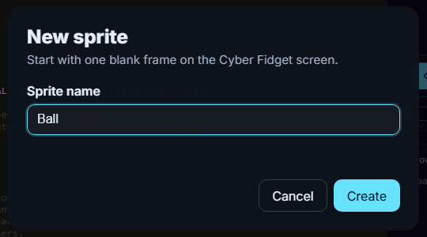
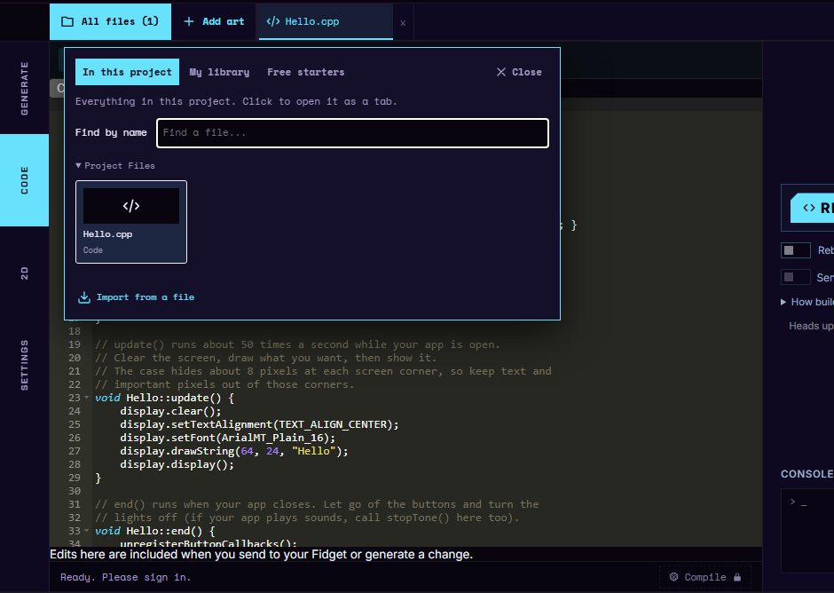
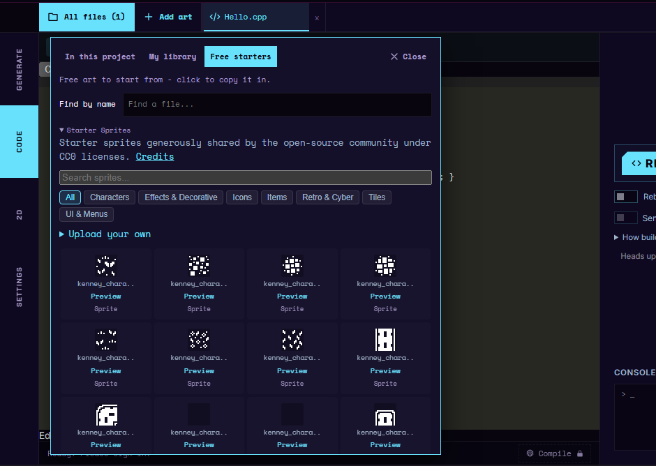
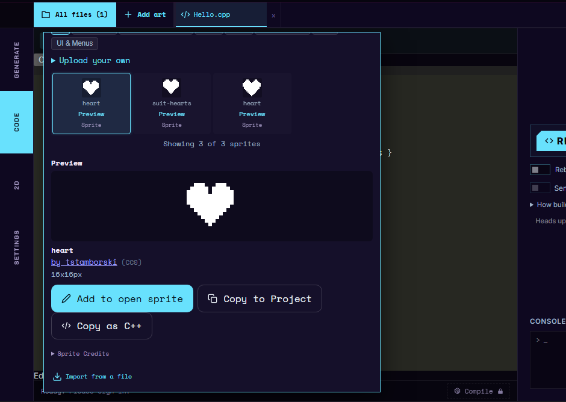
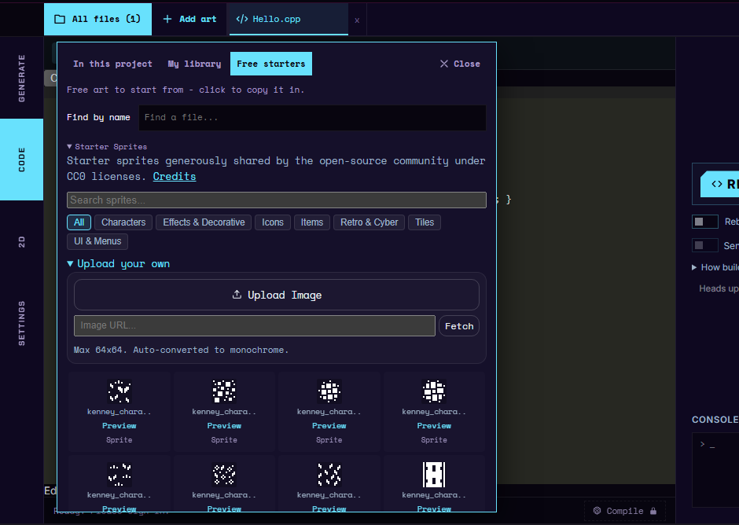

# Your Sprite Library

After this page you can find every sprite in your project, add a new one, reuse art you saved earlier, and borrow free starter art. A sprite is an image or animation used by an app, often for a character, object, or effect.

On a desktop or laptop, all of this lives behind two buttons at the left end of the file strip above the workspace: **All files** and **Add art**. The **All files** window has three tabs: **In this project**, **My library**, and **Free starters**. Taking something out of a library copies it into your project. Editing that copy never changes the original.

---

## Add art

**Add art** opens a short menu:

| Choice | What it does |
|---|---|
| **Draw a new sprite** | Opens the New sprite dialog. |
| **Import from a file** | Brings in a sprite file, a picture, or an Aseprite export. See [Keeping and sharing your work](../software/import-export.md). You can also drop files anywhere in Studio. |
| **From my library** | Opens the **My library** tab. |
| **Pick a free starter** | Opens the **Free starters** tab. |
| **Build a 3D model** | Appears only when the 3D tab is enabled for your account. |

If the project has no art yet, the 2D tab shows **This project has no art yet** with three buttons: **DRAW A SPRITE**, **IMPORT A FILE** and **PICK A STARTER**.

---

## Draw a new sprite

Choose **Add art > Draw a new sprite**, or **DRAW A SPRITE** on the empty 2D tab. A **New sprite** dialog asks for a **Sprite name**. Studio suggests one such as `Sprite 1`. Type your own name and choose **Create**. The new sprite opens in the 2D tab with one blank frame.

<video src="../../assets/media/new-sprite.webm" poster="../../assets/media/new-sprite.png" autoplay loop muted playsinline width="560"></video>

---

## In this project

Choose **All files** (the number beside it is how many files the project holds), then the **In this project** tab. It lists everything in the project as cards: your app's code file and every sprite, including sprites whose editor tabs are closed. Click a card to open it as a tab in the strip.

On a sprite card, **Rename** changes the sprite's name and **Remove** takes it out of the project after you confirm. Closing a tab with its **x** only closes that editor view. It never deletes the sprite.

**Find by name** at the top of the window filters the cards on whichever tab is open.

---

## My library

**My library** is your account's sprite library. You must be signed in to use it. Inside the tab, the section is headed **My Assets**.

To add a sprite:

1. Open the sprite you want to keep.
2. Choose **Save to My Assets**. On a desktop it is in the right-panel footer.
3. Review or change the prefilled name in the dialog.
4. Save the sprite.

Your account can hold up to 50 sprites. Saving another sprite with the same name does not overwrite the earlier one. It adds a new version under that name.

To reuse a saved sprite, open **All files > My library** and click its card. Studio copies it into the project and opens it.

To rename a saved sprite, choose **Rename** on its card, enter the new name and confirm. To take a sprite out of the library, choose **Remove** on its card and confirm in the dialog. Removing deletes the sprite from My Assets, including its saved versions, and cannot be undone. Projects that already used the sprite keep their copies.

Renaming changes the library entry only. Its saved versions are kept, and any project that already used the sprite is untouched -- that project keeps the copy, and the name, it took at the time. To rename the copy inside a project, use **Rename** on its card in **In this project** instead.

If another saved asset already uses the name you type, the rename is refused and nothing changes. Names are compared without regard to capitalization, so you can still correct a name's capitalization on its own.

---

## Free starters

**Free starters** holds a built-in collection of art that anyone may reuse. Everything in it is Creative Commons Zero (CC0), which means it can be reused without the usual copyright restrictions. The collection sits under a collapsible heading called **Starter Sprites**, with a **Search sprites...** box and category buttons such as **Characters**, **Icons** and **Tiles**.

You can use a starter in three ways:

- **Click its card.** Studio copies the sprite into your project right away and opens it.
- **Choose Preview on a card**, then use the buttons under the larger preview. The preview also shows the sprite's name, author, license and size.
- **Drag a card** onto the canvas of an open sprite. The window closes and the sprite is placed where you drop it.

The three buttons under the preview do different things:

- **Add to open sprite** combines the starter art with your current drawing as a new layer.
- **Copy to Project** adds the starter sprite to the project as its own sprite file.
- **Copy as C++** copies the sprite to your clipboard as C++ code you can add to an app you write by hand. The code holds the sprite's pixels as a 1-bit bitmap (every visible pixel is on), its width and height, a credit line naming its author and license, and a usage comment showing the drawing call, `display.drawXbm(x, y, width, height, bitmap)`. See [Bitmaps](../concepts/display.md#bitmaps-drawxbm) for how the device draws it. The button briefly shows how many bytes were copied.

The three buttons sit below the scrolling grid, so scroll down inside the window to reach them. **Copy as C++** wraps onto a second row under the other two.

<video preload="none" data-src="../../assets/media/free-starters-copy.webm" poster="../../assets/media/free-starters-copy.png" loop muted playsinline width="560"></video>

### Upload your own

Under the category buttons, **Upload your own** opens a small box with **Upload Image**, an **Image URL...** field with a **Fetch** button, and the note **Max 64x64. Auto-converted to monochrome.** Studio scales a larger picture down and turns it into black-and-white pixels. The result appears in the starter grid under **My Sprites**, with the author shown as You, and is kept in this browser only. Then use it like any other starter.

---

## On a phone

On a phone, the 2D tab has no file strip. Tap the **Files** chip at the top of the screen (it shows the open sprite's name). Its **Files** sheet lists this project's sprites with **Rename** and **Remove**, plus **New sprite** and **Add from file**. It also holds **Save to My Assets**. **My library** and **Free starters** are in the desktop window described above.

---

## Copies stay independent

Using a sprite from any library copies it into your project. Editing the project copy never changes the library original.

A small note on the copy records where it came from. This helps you recognize reused art without creating a live link back to the source.

---

## Sprites travel with your app

Sprite files are part of the app project. When you build the app (Studio's step that turns your project into a runnable app), Studio compiles your art into the app automatically. When you install the app on your device, its sprites go with it.

The complete sequence is:

1. Author your app.
2. Draw its art in Studio.
3. Build the app.
4. Install the app on the device.

No sprite export or import is required between drawing, building, and installing. To back up a sprite or take it elsewhere, see [Keeping and sharing your work](../software/import-export.md).

For sprites with multiple actions, continue with [Animation names](animation-states.md). For backups and downloads, see [Files and versions](files-and-versions.md).
