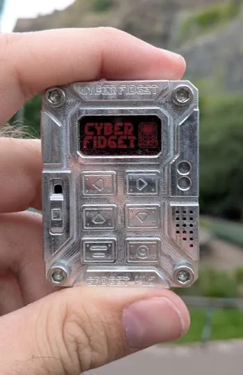
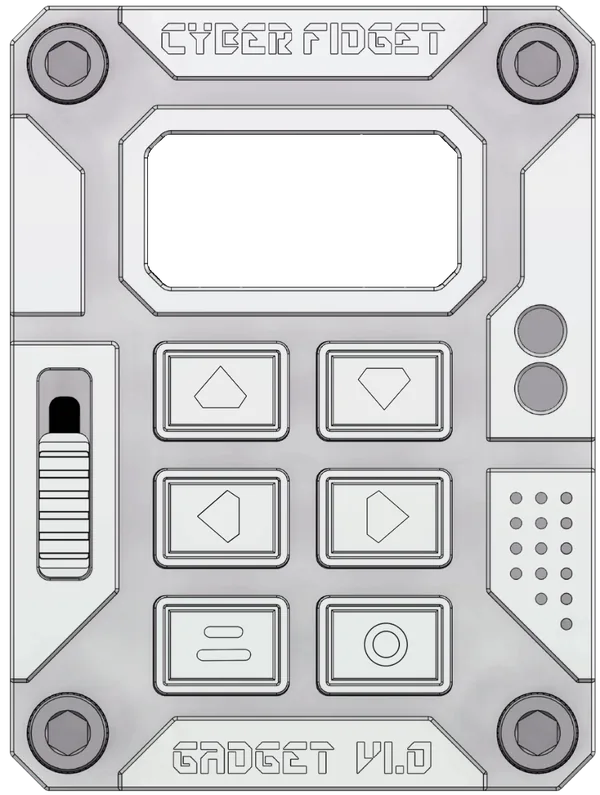
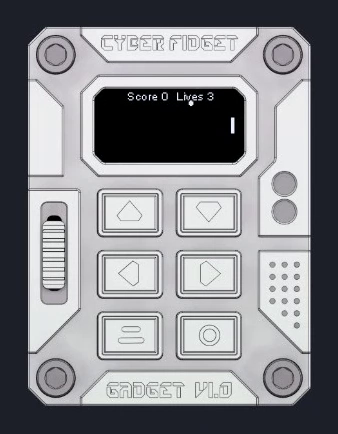
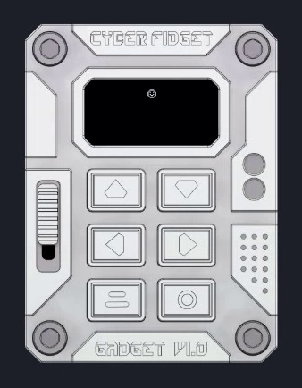
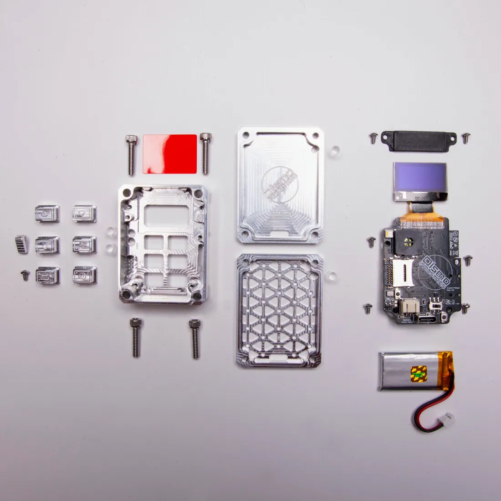

<!-- Cyber Fidget documentation - CC BY-SA 4.0 -->
# Your Fidget

{ .no-lightbox width="350" height="540" }

<strong>Play it, charge it, add apps and keep it up to date.</strong>

After this page you will know where to find each part of using and looking after your Cyber Fidget, and where to look when something goes wrong.

[Turn it on](../getting-started/overview.md#2-turn-it-on-and-find-your-way-around){ .md-button .md-button--primary }
[Built-in apps](../software/apps.md){ .md-button }

## Start here

-   { .cf-contain .no-lightbox loading=lazy width="300" height="397" }

    **Turn it on and find your way around**

    ---

    Which button moves through the menu, opens an app and goes back.

    [Turn it on](../getting-started/overview.md#2-turn-it-on-and-find-your-way-around)

-   { .cf-contain .no-lightbox loading=lazy width="300" height="400" }

    **Play the built-in apps**

    ---

    Games, screensavers and tools that come on every Fidget, with their controls.

    [Built-in apps](../software/apps.md)

-   { .cf-contain .no-lightbox loading=lazy width="300" height="400" }

    **Get more apps**

    ---

    Browse The Archives, try an app in your browser, then send it to your Fidget.

    [Get apps from The Archives](../software/sharing-apps.md)

-   { .cf-focus-end .no-lightbox loading=lazy width="1100" height="1100" }

    **Charge it**

    ---

    Plug in a USB-C cable to charge. When it runs on battery, it sleeps after about a minute without use; press the bottom-right button to wake it.

    [Battery and Power](../product/battery-and-power.md)

---

## Battery and storage

-   **When the battery runs low**

    ---

    It shuts down to protect the battery. Charge it, then switch it off and on again.

    [When the battery runs very low](../product/battery-and-power.md#when-the-battery-runs-very-low)

-   **Memory card**

    ---

    What the microSD card holds, which cards work, and how to swap one safely.

    [Storage & SD](../software/storage.md)

---

## Built-in features

-   **Voice Notes**

    ---

    Record voice memos to the memory card and play them back on the device.

    [Voice Notes](../firmware/voice-recorder.md)

-   **Web Portal**

    ---

    Join your Fidget's own WiFi from your phone to manage music and save your home WiFi.

    [Web Portal](../firmware/web-portal.md)

-   **Phone Companion**

    ---

    Hear what the Fidget hears on your phone, with live captions on its screen.

    [Phone Companion](../firmware/companion.md)

-   **Awake & dev mode**

    ---

    Keep the Fidget from sleeping while you work, or let it receive apps over WiFi.

    [Awake & dev mode](../software/awake-and-dev-mode.md)

---

## Keep it updated

-   **Updates**

    ---

    When your Fidget checks for app changes and firmware updates (its built-in software), and how to check manually.

    [Updates](../software/updates.md)

-   **Update or reset**

    ---

    Update from the website, go back to an earlier version, or start over with a clean Fidget.

    [Update or reset your Fidget](../software/updating.md)

---

## Your account

-   **Link your Fidget**

    ---

    Put your Fidget on your account so apps you send reach it over WiFi, with no cable.

    [Link your Fidget](../software/link-your-fidget.md)

-   **Your Fidgets**

    ---

    See every Fidget on your account, rename one, and arrange its menu.

    [Your Fidgets](../software/your-fidgets.md)

-   **Battery data**

    ---

    Choose whether to share your Fidget's battery record. It is off until you turn it on.

    [Battery data](../software/battery-data.md)

-   **Beta Access**

    ---

    Ask for the features that are in closed beta, and see where your request stands.

    [Beta Access](../software/beta-access.md)

---

## Share your work

-   **Keep and share your work**

    ---

    Save sprites, models and whole projects to files, or send someone a share link.

    [Keeping and sharing your work](../software/import-export.md)

-   **Submit to The Archives**

    ---

    Send an app you made for review so everyone can find and install it.

    [Submit your app to The Archives](../software/submit-to-archives.md)

---

## If something goes wrong

| What happens | Where to look |
|---|---|
| It won't wake up after the battery ran low | [How to start again](../product/battery-and-power.md#how-to-start-again) |
| It doesn't start properly | [Erase everything and reinstall](../software/updating.md#erase-everything-and-reinstall-on-the-website) |
| It can't join WiFi or the Web Portal won't open | [Web Portal common issues](../firmware/web-portal.md#common-issues) |
| An update check fails | [If a check does not work](../software/updates.md#if-a-check-does-not-work) |
| Linking to your account doesn't finish | [If linking does not finish](../software/link-your-fidget.md#if-linking-does-not-finish) |
| Sending an app over the cable fails | [If a send does not work](../software/awake-and-dev-mode.md#if-a-send-does-not-work) |
| The Phone Companion misbehaves | [Phone Companion troubleshooting](../firmware/companion.md#troubleshooting) |
| An app from The Archives doesn't work | [Report a problem](../software/sharing-apps.md#report-a-problem) |
